# Jarkom-Modul-3-2026-K-25

## Anggota
| Nama | NRP | 
|---|---|
| Muhammad Yusuf | 5027251067 |
| Azhari Rahma Putri | 5027251114 |

## Laporan

1. Ketika Curtain menutup Shibuya, jalur komunikasi antar zona Jujutsu High terputus. Pulihkan konektivitas dasar dengan mengonfigurasi jichi: eth0 memperoleh WAN dari NAT, sedangkan eth1–eth4 menjadi gateway Network 1–4 sesuai tabel pemetaan. Aktifkan IPv4 forwarding dan source NAT, lalu tetapkan IP statis host infrastruktur sesuai tabel spesifikasi. Buktikan konektivitas setiap host ke gateway dan akses eksternal dari host yang relevan.

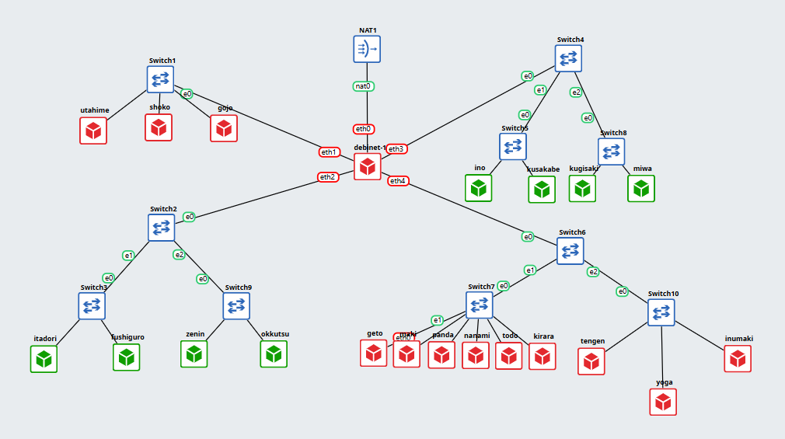
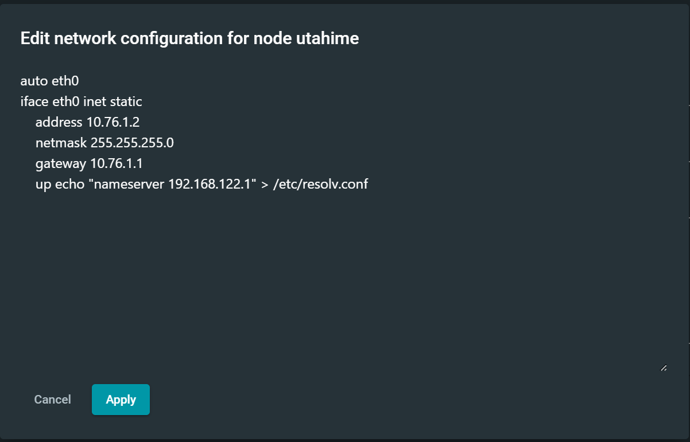
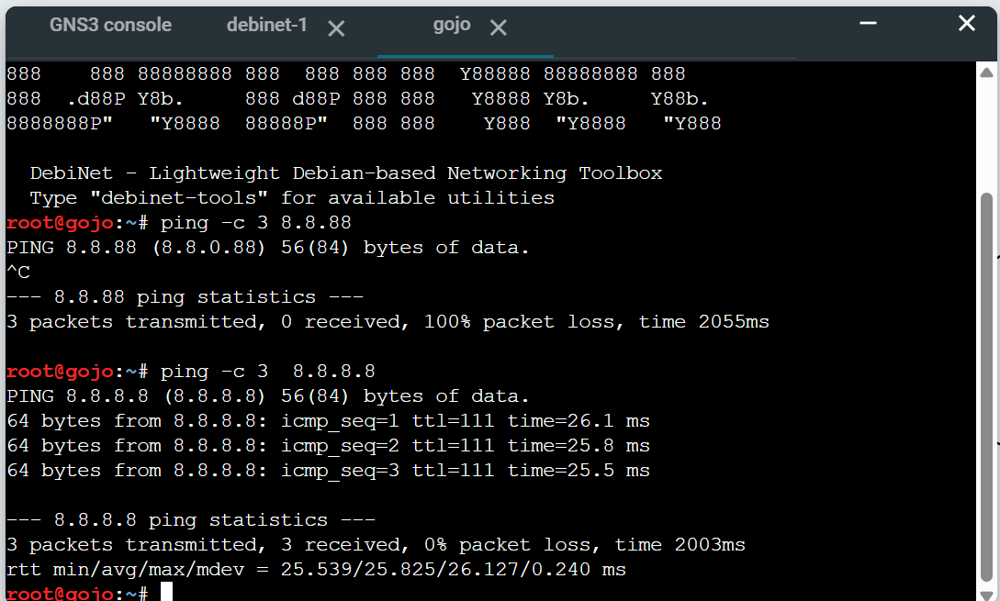

Bisa dilihat bahwa konfigurasi jaringan pada node utahime menggunakan IP statis 10.76.1.2 dengan gateway 10.76.1.1.
Selain itu, berdasarkan hasil uji ping ke 8.8.8.8, tercatat 0% packet loss, yang membuktikan bahwa routing, IPv4 forwarding, dan Source NAT (MASQUERADE) pada router utama telah berhasil dijalankan dan host sudah bisa mengakses internet.

2. Tengen, penjaga pusat distribusi di Data Center, harus mengambil alih pengalokasian alamat bagi wilayah yang membutuhkan konfigurasi dinamis. Konfigurasikan isc-dhcp-server pada [PREFIX IP].4.10. Deklarasikan Network 4 ([PREFIX IP].4.0/24) sebagai subnet lokal tanpa pool dinamis, lalu siapkan scope DHCP untuk Network 2 ([PREFIX IP].2.0/24) dan Network 3 ([PREFIX IP].3.0/24). Validasi konfigurasi dan pastikan service aktif tanpa error “No subnet declaration”.

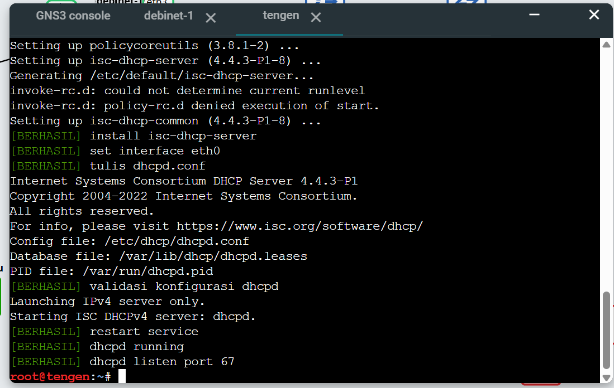
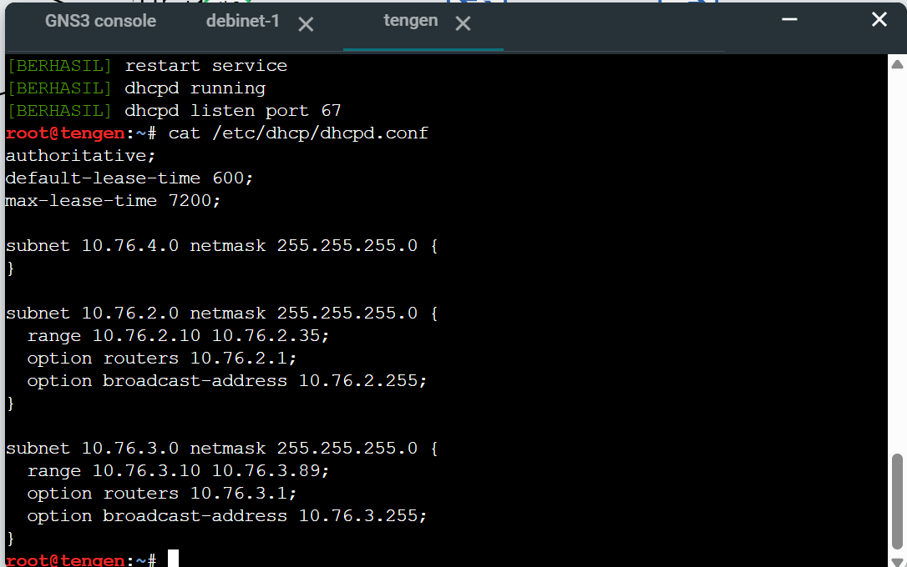

Bisa dilihat dari isi file /etc/dhcp/dhpd.conf dan status eksekusi layanan pada node tengen:   
- Subnet Lokal Network 4 (10.76.4.0/24): Dideklarasikan secara kosong (subnet 10.76.4.0 netmask 255.255.255.0 {}) tanpa pool dinamis untuk menghindari error "No subnet declaration for eth0".
- DHCP Scope Network 2 & Network 3: Dikonfigurasi dengan range IP, gateway (option routers), serta broadcast address sesuai spesifikasi subnet masing-masing.
- Validasi Service: Layanan isc-dhcp-server berhasil di-restart dan berjalan aktif (running) serta mendengarkan pada port 67 (dhcpd listen port 67) tanpa error.   

3. Permintaan alamat dari Divisi A dan Divisi B tidak dapat menyeberangi subnet secara langsung. Konfigurasikan jichi sebagai DHCP Relay menuju tengen ([PREFIX IP].4.10), menggunakan eth2 untuk Network 2 dan eth3 untuk Network 3. Buktikan bahwa client dari kedua subnet berhasil memperoleh lease melalui relay.

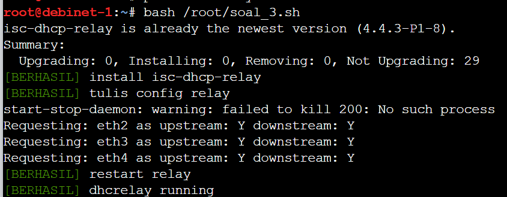
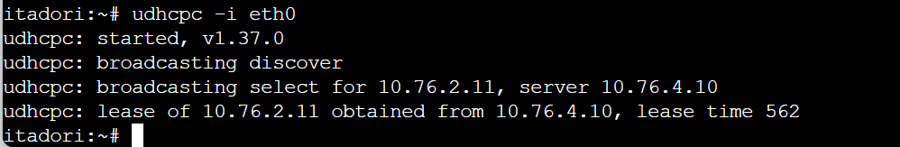
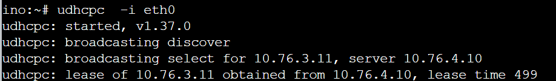

Bisa dilihat dari hasil eksekusi script dan perintah client pada gambar:
- Konfigurasi DHCP Relay: Layanan isc-dhcp-relay berhasil diinstal dan diaktifkan pada router jichi untuk meneruskan request DHCP dari Network 2 (eth2) dan Network 3 (eth3) menuju DHCP Server tengen (10.76.4.10) melalui eth4.
- Pengujian Client Network 2 (itadori): Menjalankan udhcpc -i eth0 dan berhasil mendapatkan alokasi IP 10.76.2.11 dari DHCP Server 10.76.4.10.
- Pengujian Client Network 3 (ino): Menjalankan udhcpc -i eth0 dan berhasil mendapatkan alokasi IP 10.76.3.11 dari DHCP Server 10.76.4.10.
Hal ini membuktikan bahwa DHCP Relay pada router jichi telah berfungsi dengan baik dalam menyeberangkan permintaan IP antar-subnet.

4. Agar tim Dev dan Support di Divisi A menerima jatah alamat yang berbeda, atur dua pool DHCP pada Network 2. Tetapkan Pool 1 ([PREFIX IP].2.10–[PREFIX IP].2.35) untuk itadori dan fushiguro, serta Pool 2 ([PREFIX IP].2.70–[PREFIX IP].2.95) untuk zenin dan okkotsu. Rentang [PREFIX IP].2.36–[PREFIX IP].2.69 tidak boleh dialokasikan. Karena seluruh client berada pada subnet yang sama, gunakan DHCP class berdasarkan MAC Address atau Client ID untuk memisahkan kedua kelompok.
### Pengecekan MAC Address Client
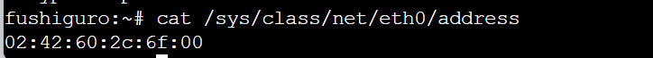
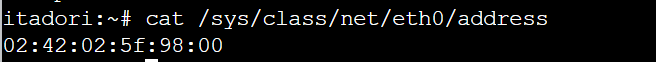
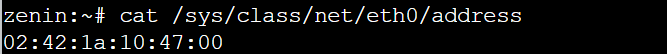
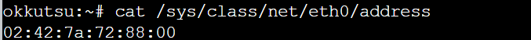
### Validasi Script dan Konfigurasi DHCP Server
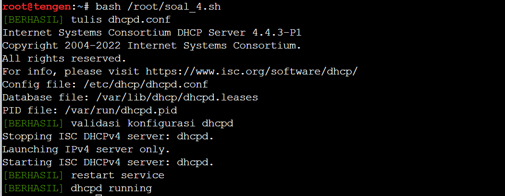

### Alamat Lease Host Network 2 (Pool 1)
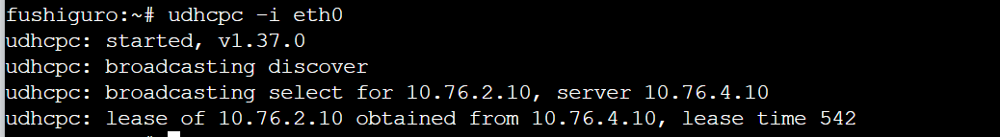
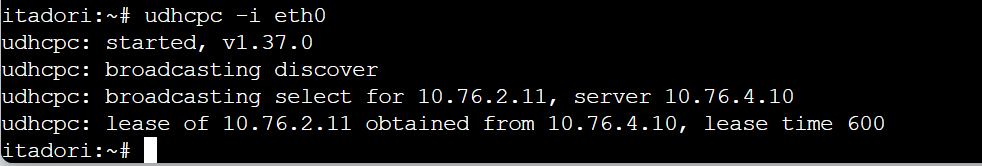

### Alamat Lease Host Network 2 (Pool 2)
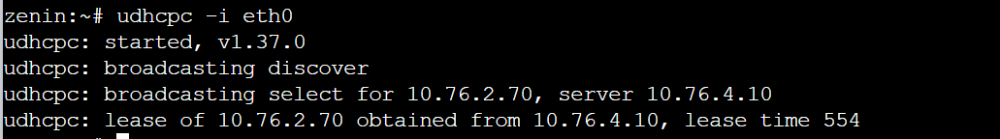
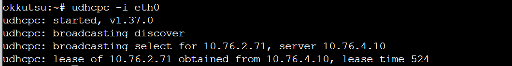

Bisa dilihat bahwa konfigurasi DHCP server pada node tengen telah berhasil diterapkan menggunakan script validasi:  
- Pool 1 (10.76.2.10 – 10.76.2.35): Dialokasikan untuk host fushiguro (10.76.2.10) dan itadori (10.76.2.11) berdasarkan pengelompokan kelas MAC Address/Client ID masing-masing.
- Pool 2 (10.76.2.70 – 10.76.2.95): Dialokasikan untuk host zenin (10.76.2.70) dan okkotsu (10.76.2.71) berdasarkan MAC Address kelompok kedua.
- Rentang Kosong (10.76.2.36 – 10.76.2.69): Dibiarkan tidak dialokasikan sesuai dengan ketentuan soal.

5. Setiap tim lapangan memiliki durasi operasi yang berbeda. Pada Network 3, berikan short lease 30 menit (1800 detik) kepada ino dan kusakabe, serta long lease 12 jam (43200 detik) kepada miwa. Gunakan pool short lease [PREFIX IP].3.10–[PREFIX IP].3.89 dan pool long lease [PREFIX IP].3.100–[PREFIX IP].3.199. Sesuaikan default-lease-time dan max-lease-time untuk setiap kelas client. Berikan pula DHCP options berupa DNS [PREFIX IP].1.2 dan [PREFIX IP].1.3, serta domain-search <xxxx>.com.
### Pengecekan MAC Address Client
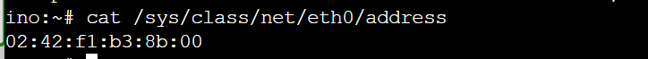
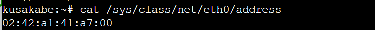
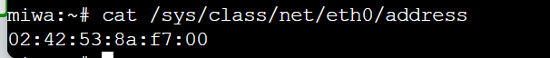

### Validasi Script dan Konfigurasi DHCP Server
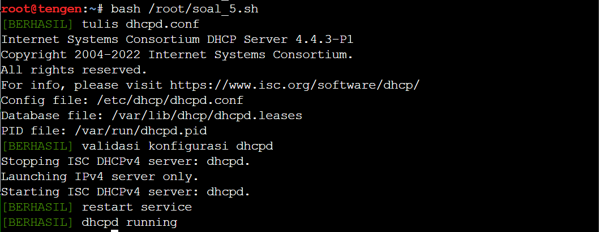

### Alamat Lease dan Lease Time Client Network 3
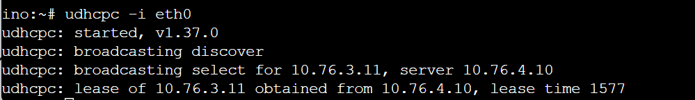
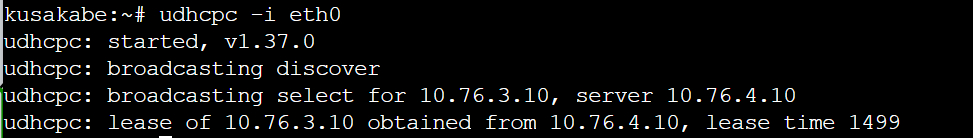
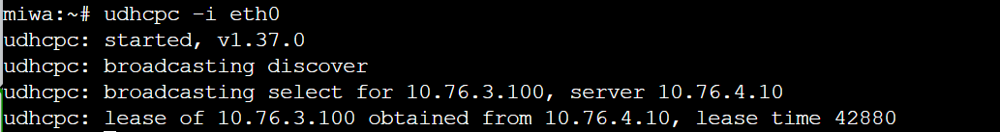

Bisa dilihat dari hasil eksekusi script di tengen dan pengujian client di Network 3:   
- Short Lease (Pool 10.76.3.10 – 10.76.3.89):Dialokasikan untuk host ino (10.76.3.11) dan kusakabe (10.76.3.10) berdasarkan pencocokan MAC Address.   Mendapatkan lease time sekitar 1800 detik (30 menit).
- Long Lease (Pool 10.76.3.100 – 10.76.3.199):Dialokasikan untuk host miwa (10.76.3.100) berdasarkan MAC Address-nya.   Mendapatkan lease time sekitar 43200 detik (12 jam).
- DHCP Options: Masing-masing client menerima opsi DNS Server (10.76.1.2, 10.76.1.3) dan pencarian domain.

6. Kugisaki ditetapkan sebagai personel VIP yang harus mempertahankan alamat yang sama setiap kali terhubung. Buat DHCP static lease berdasarkan MAC Address client tersebut dengan fixed address [PREFIX IP].3.99. Pastikan alamat ini berada di luar seluruh pool dinamis, validasi konfigurasi server, lalu renew lease pada client. Buktikan bahwa alamat yang diterima sesuai dengan reservasi.
### Validasi Konfigurasi DHCP Server
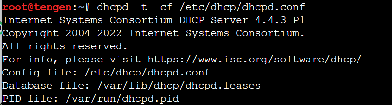

### Konfigurasi Fixed Address Host Kugisaki
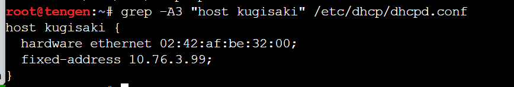

### Hasil Renew Lease pada Client Kugisaki
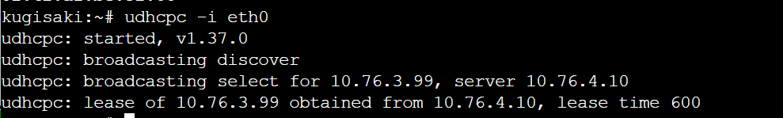

Bisa dilihat dari konfigurasi server dan hasil pengujian client pada gambar:
- Reservasi IP Statis: Pada file /etc/dhcp/dhcpd.conf node tengen, dibuat blok host kugisaki yang mendaftarkan MAC Address 02:42:af:be:32:00 dengan fixed-address 10.76.3.99 (di luar pool dinamis).
- Validasi Server: Konfigurasi divalidasi dengan dhcpd -t -cf /etc/dhcp/dhcpd.conf dan terbukti bebas error syntax.
- Pengujian Client: Saat kugisaki menjalankan udhcpc -i eth0, client berhasil memperoleh IP reservasi 10.76.3.99 dari DHCP Server 10.76.4.10.

7. Setelah aturan alokasi diterapkan, pastikan setiap client menerima konfigurasi jaringan sesuai wilayahnya: subnet mask 255.255.255.0 (/24), gateway dan broadcast address yang benar, DNS [PREFIX IP].1.2 serta [PREFIX IP].1.3, dan domain-search yang ditentukan. Periksa IP address dan routing seluruh client Divisi A dan Divisi B, kemudian cocokkan lease dengan /var/lib/dhcp/dhcpd.leases pada tengen. Pastikan tidak ada alamat yang bertabrakan atau berada di luar kebijakan pool.

### Validasi Konfigurasi IP, Gateway, dan DNS pada salah satu Client
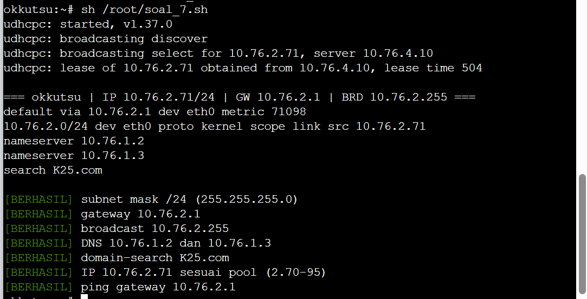

### Pencocokan Lease DHCP dan Pemeriksaan Bentrok IP di Server Tengen
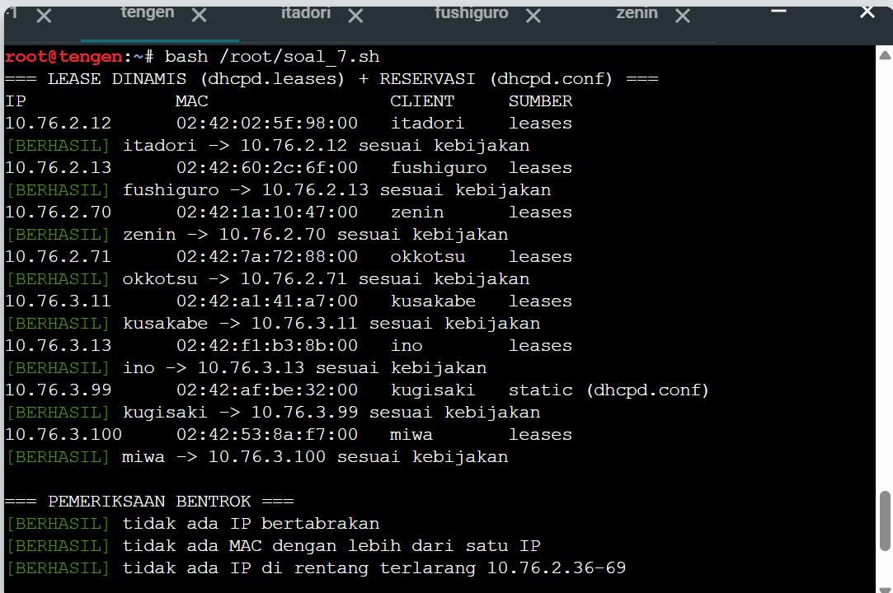
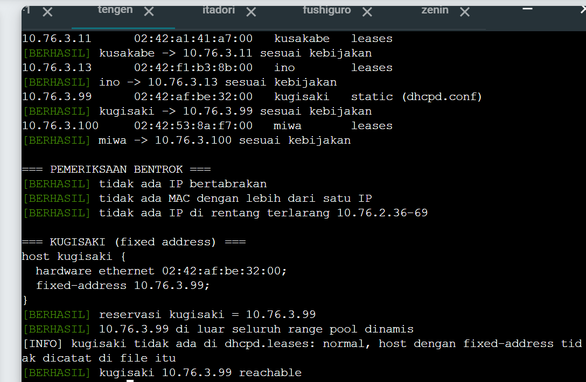

Bisa dilihat dari hasil eksekusi script validasi pada client dan server tengen: - Validasi Client: Host (seperti okkotsu) menerima konfigurasi jaringan yang sesuai meliputi subnet mask /24, gateway, broadcast, DNS Server (10.76.1.2, 10.76.1.3), serta domain-search K25.com.   
- Pencocokan Lease: Berdasarkan pemeriksaan /var/lib/dhcp/dhcpd.leases dan reservasi dhcpd.conf, seluruh client (itadori, fushiguro, zenin, okkotsu, kusakabe, ino, kugisaki, miwa) mendapatkan IP yang sesuai dengan kebijakan pool dan reservasi masing-masing.
- Pemeriksaan Bentrok: Sistem memastikan bahwa tidak ada IP yang bertabrakan, tidak ada duplikasi MAC Address, serta tidak ada alokasi pada rentang terlarang (10.76.2.36–69).

8. Sebelum Curtain dibuka kembali, buktikan bahwa proses pemberian alamat berjalan sesuai protokol. Lakukan packet capture saat salah satu client Network 2 atau Network 3 meminta lease baru. Gunakan tcpdump pada tengen atau jalur menuju Data Center untuk menunjukkan urutan DHCPDISCOVER → DHCPOFFER → DHCPREQUEST → DHCPACK. Identifikasi alamat server, alamat yang diberikan, lease time, dan field giaddr. Pastikan nilai giaddr sesuai dengan interface jichi yang menerima request dari subnet client.


11. Utahime dan Shoko ditugaskan membangun sistem penamaan domain resmi agar seluruh pos tidak perlu menghafal alamat IP mentah. Konfigurasikan BIND9 pada utahime sebagai DNS Master dan shoko sebagai DNS Slave untuk mengelola domain jujutsu.<xxxx>.com. Atur SOA record, NS delegasi untuk kedua server, dan terapkan allow-transfer dari Master ke Slave. Pastikan file zona berhasil tersinkronisasi otomatis ke shoko saat nomor serial di utahime dinaikkan, lalu buktikan dengan melakukan query dig ke kedua server dari salah satu client.

### Pendahuluan
Pada soal ini, meminta mengonfigurasi DNS Master pada Utahime dan DNS Slave pada Shoko untuk zona `jujutsu.k25.com`, kemudian menguji resolusi DNS dan konsistensi data zona dari client Okkutsu.

### Topologi dan alamat IP

| Node | Peran | Alamat IP |
|---|---|---|
| Utahime | DNS Master | `10.76.1.2` |
| Shoko | DNS Slave | `10.76.1.3` |
| Okkutsu | Client pengujian | `10.76.2.70` |

Zona DNS yang digunakan adalah `jujutsu.k25.com`.

### Konfigurasi DNS Master

Pada Utahime, zona dikonfigurasi dengan tipe `master`. Transfer zona diizinkan untuk Shoko (`10.76.1.3`) melalui `allow-transfer`, dan notifikasi perubahan zona dikirim menggunakan `also-notify`.

File zona `/etc/bind/db.jujutsu.k25.com` memuat record SOA, NS, record A untuk server DNS, serta record uji `sync-test.jujutsu.k25.com` dengan alamat `10.76.1.99`.

Contoh record penting:
- `ns1.jujutsu.k25.com` → `10.76.1.2`
- `ns2.jujutsu.k25.com` → `10.76.1.3`
- `sync-test.jujutsu.k25.com` → `10.76.1.99`

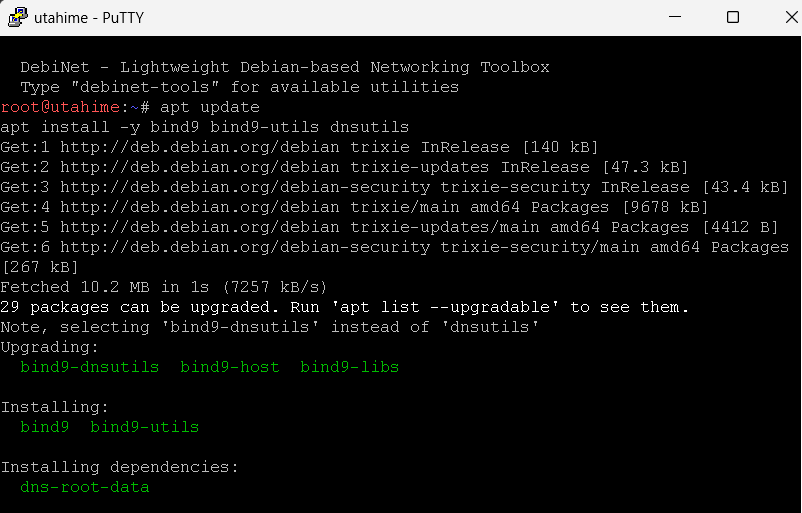
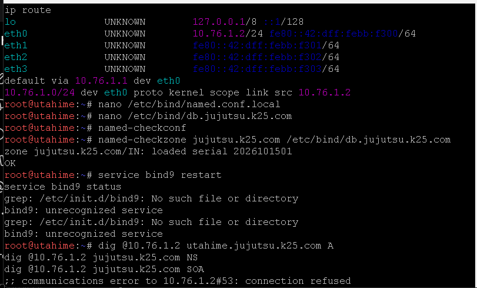
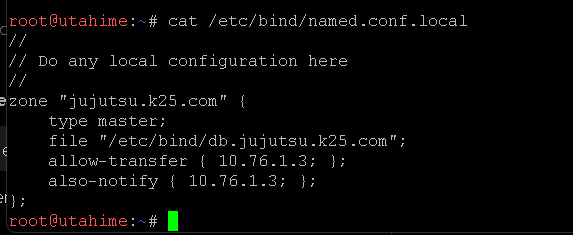

### Konfigurasi DNS Slave

Pada Shoko, zona yang sama dikonfigurasi dengan tipe `slave` dan Master `10.76.1.2`. Salinan zona disimpan di `/var/cache/bind/db.jujutsu.k25.com`.


### Validasi konfigurasi
Perintah `named-checkconf` digunakan untuk memeriksa sintaks konfigurasi BIND. Pada Master, `named-checkzone jujutsu.k25.com /etc/bind/db.jujutsu.k25.com` digunakan untuk memvalidasi file zona.

### Pengujian record A dari client Okkutsu
Perintah:
```bash
dig @10.76.1.2 sync-test.jujutsu.k25.com A
dig @10.76.1.3 sync-test.jujutsu.k25.com A
```

Hasil pengujian menunjukkan kedua server menjawab `NOERROR` dan mengembalikan alamat `10.76.1.99`.

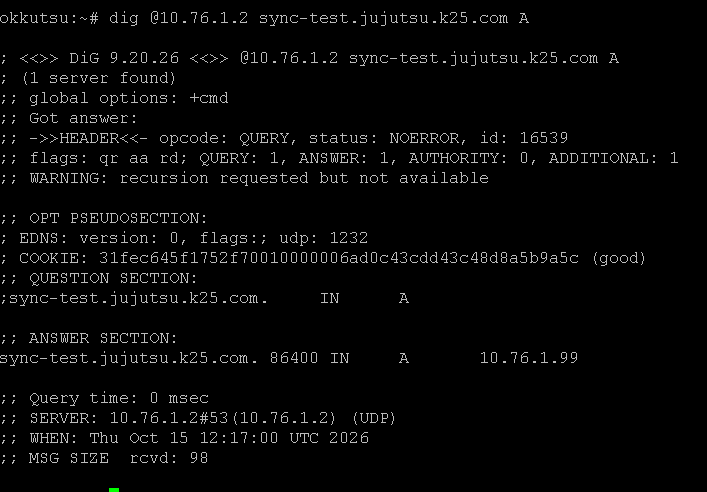

### Pengujian SOA dan serial
Perintah:
```bash
dig @10.76.1.2 jujutsu.k25.com SOA
dig @10.76.1.3 jujutsu.k25.com SOA
```

Kedua server mengembalikan serial `2026101502`. Serial tersebut merupakan versi zona yang diuji setelah record `sync-test` ditambahkan dan serial dinaikkan.

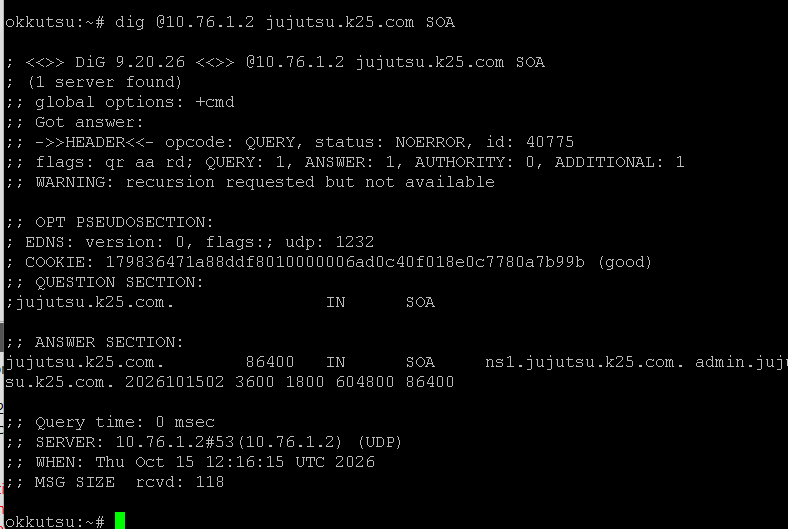

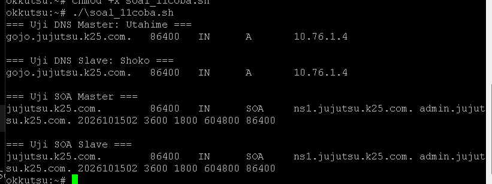


Kesamaan jawaban record A pada Master dan Slave, serta kesamaan serial SOA `2026101502`, menunjukkan bahwa data zona pada kedua DNS server konsisten. Hasil ini mendukung bahwa transfer/sinkronisasi zona telah berhasil.

Flag `aa` pada jawaban `dig` menunjukkan bahwa jawaban diberikan secara otoritatif. Peringatan `recursion requested but not available` bukan kegagalan resolusi; konfigurasi DNS memang menonaktifkan recursion.

### Kesimpulan
DNS Master pada Utahime dan DNS Slave pada Shoko berhasil melayani query untuk zona `jujutsu.k25.com`. Client Okkutsu berhasil memperoleh record `sync-test.jujutsu.k25.com` dengan IP `10.76.1.99` dari kedua server. Pemeriksaan SOA juga menunjukkan serial yang sama, yaitu `2026101502`, sehingga konsistensi data zona berhasil diverifikasi.

12. Peta domain harus memetakan pintu masuk utama dan tetap bisa mencari alamat di luar kawasan Shibuya. Pada utahime, buat A record jujutsu.<xxxx>.com yang mengarah ke gojo, serta CNAME www yang merujuk ke domain utama tersebut. Buat pula Reverse DNS (zona PTR) untuk melacak IP gojo kembali ke domain resminya, dan aktifkan fitur DNS Forwarder pada BIND9 mengarah ke IP gateway internet (192.168.122.1). Uji dari client dengan dig untuk mengecek CNAME, PTR, dan buktikan client tetap bisa melakukan ping ke domain internet seperti google.com.

### Pendahuluan
Soal ini bertujuan untuk mengonfigurasi layanan DNS menggunakan BIND9 agar dapat memetakan nama domain ke alamat IP, menyediakan alias domain, melakukan Reverse DNS, dan meneruskan permintaan DNS ke jaringan internet.

Konfigurasi menggunakan Utahime sebagai DNS Master, Shoko sebagai DNS Slave, Gojo sebagai host tujuan, dan Okkutsu sebagai client.

### Topologi dan Alamat IP

| Node | Peran | Alamat IP |
|---|---|---|
| Utahime | DNS Master dan DNS Forwarder | `10.76.1.2` |
| Shoko | DNS Slave | `10.76.1.3` |
| Gojo | Host tujuan domain | `10.76.1.4` |
| Okkutsu | Client DNS | `10.76.2.70/24` |
| Gateway internet | DNS Forwarder | `192.168.122.1` |

Domain yang digunakan adalah `jujutsu.k25.com`.

Okkutsu berada di subnet `10.76.2.0/24`, sedangkan Utahime dan Shoko berada di subnet `10.76.1.0/24`. Perbedaan subnet ini perlu diperhatikan ketika mengatur hak akses DNS rekursif.

### Konfigurasi DNS Master pada Utahime

Script yang digunakan: `soal_12_utahime.sh`

Utahime bertindak sebagai DNS Master yang menyimpan konfigurasi zona forward dan reverse. Script membuat atau memperbarui konfigurasi berikut:

- `/etc/bind/named.conf.local`
- `/etc/bind/named.conf.options`
- `/etc/bind/db.jujutsu.k25.com`
- `/etc/bind/db.10.76.1`

### Forward Zone

Forward zone digunakan untuk menerjemahkan nama domain menjadi alamat IP.

Record utama yang dikonfigurasi adalah:

| Record | Tipe | Nilai |
|---|---|---|
| `jujutsu.k25.com` | A | `10.76.1.4` |
| `www.jujutsu.k25.com` | CNAME | `jujutsu.k25.com` |
| `ns1.jujutsu.k25.com` | A | `10.76.1.2` |
| `ns2.jujutsu.k25.com` | A | `10.76.1.3` |
| `gojo.jujutsu.k25.com` | A | `10.76.1.4` |

A record menghubungkan domain utama dengan IP Gojo. CNAME membuat `www.jujutsu.k25.com` menjadi alias dari domain utama.

### Reverse DNS

Reverse DNS digunakan untuk mencari nama domain berdasarkan alamat IP.

Zona reverse yang digunakan adalah `1.76.10.in-addr.arpa`. Record berikut menghubungkan alamat `10.76.1.4` dengan nama domain resminya:

```dns
4 IN PTR jujutsu.k25.com.
```

Dengan demikian, query PTR untuk `10.76.1.4` diharapkan mengembalikan `jujutsu.k25.com`.

### DNS Forwarder dan Recursion

DNS Forwarder digunakan untuk meneruskan permintaan DNS yang tidak dapat dijawab langsung oleh zona lokal ke server DNS lain.

Forwarder yang digunakan adalah `192.168.122.1`.

Konfigurasi penting pada `/etc/bind/named.conf.options` adalah:

```conf
recursion yes;

allow-query { any; };

allow-recursion {
    127.0.0.1;
    10.76.1.0/24;
    10.76.2.0/24;
};

allow-query-cache {
    127.0.0.1;
    10.76.1.0/24;
    10.76.2.0/24;
};

forwarders {
    192.168.122.1;
};

forward first;
```

Aturan `allow-recursion` mengizinkan client tertentu meminta resolusi DNS rekursif. Sementara itu, `allow-query-cache` mengizinkan client dari jaringan yang ditentukan mengakses hasil cache DNS.

Subnet `10.76.2.0/24` harus disertakan karena Okkutsu menggunakan IP `10.76.2.70`.

Setelah konfigurasi dibuat, script menjalankan `named-checkconf` dan `named-checkzone` untuk memeriksa konfigurasi. Jika valid, BIND dimuat ulang agar perubahan dapat diterapkan.

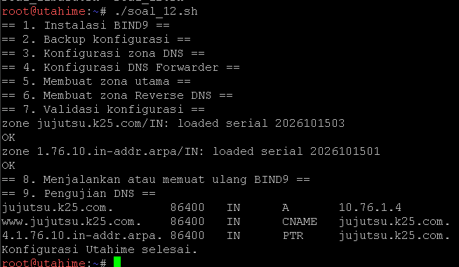

### Konfigurasi DNS Slave pada Shoko

Script yang digunakan: `soal_12_shoko.sh`

Shoko berfungsi sebagai DNS Slave yang menerima salinan zona dari Utahime. Zona yang dikonfigurasi meliputi:

- `jujutsu.k25.com`
- `1.76.10.in-addr.arpa`

Konfigurasi zona menggunakan tipe `slave` dengan Utahime (`10.76.1.2`) sebagai master. Data zona disimpan di `/var/cache/bind`.

Mekanisme zone transfer membuat Shoko memperoleh data dari Utahime, sehingga Shoko dapat memberikan jawaban authoritative untuk zona yang telah berhasil ditransfer.

Pada konfigurasi Shoko, recursion dinonaktifkan karena fungsi utamanya adalah menyediakan salinan zona DNS, bukan melayani permintaan rekursif untuk domain internet.

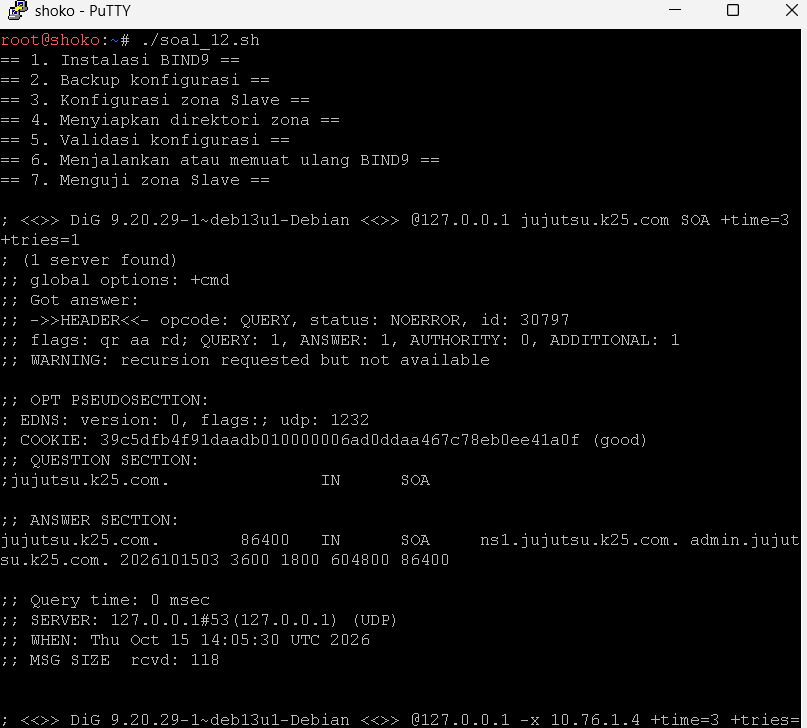

### Konfigurasi Client Okkutsu

Script yang digunakan: `soal_12_okkutsu.sh`

Okkutsu bertindak sebagai client yang mengirimkan permintaan DNS ke Utahime.

Script melakukan backup `/etc/resolv.conf`, kemudian menetapkan DNS server:

```conf
nameserver 10.76.1.2
options timeout:2 attempts:2
```

Setelah itu, script menguji A record, CNAME, PTR, resolusi domain internet, dan konektivitas melalui ping.

Konfigurasi DNS client ini memastikan permintaan resolusi nama dikirim ke Utahime. Jika DHCP atau pengelola jaringan mengubah kembali `/etc/resolv.conf`, konfigurasi client mungkin perlu diterapkan ulang.

### Pengujian

Pengujian dilakukan dari client Okkutsu menggunakan perintah berikut.

### Pengujian A Record

```bash
dig @10.76.1.2 jujutsu.k25.com A
```

Hasil yang diharapkan adalah alamat `10.76.1.4`.

### Pengujian CNAME

```bash
dig @10.76.1.2 www.jujutsu.k25.com CNAME
```

Hasil yang diharapkan adalah CNAME menuju `jujutsu.k25.com`.

### Pengujian Reverse DNS

```bash
dig @10.76.1.2 -x 10.76.1.4
```

Hasil yang diharapkan adalah PTR menuju `jujutsu.k25.com`.

### Pengujian DNS Forwarder

```bash
dig @10.76.1.2 google.com A
```

Pengujian berhasil apabila query menghasilkan `status: NOERROR` dan jawaban berisi alamat IP Google.

### Pengujian Konektivitas Internet

```bash
ping -c 3 google.com
```

Jika DNS dan jalur jaringan berfungsi serta ICMP tidak diblokir, ping akan mendapatkan balasan dari alamat IP yang berhasil di-resolve.

### Pengujian DNS Slave

```bash
dig @10.76.1.3 jujutsu.k25.com A
```

Pengujian ini memastikan Shoko dapat menjawab query zona setelah transfer dari Utahime berhasil.

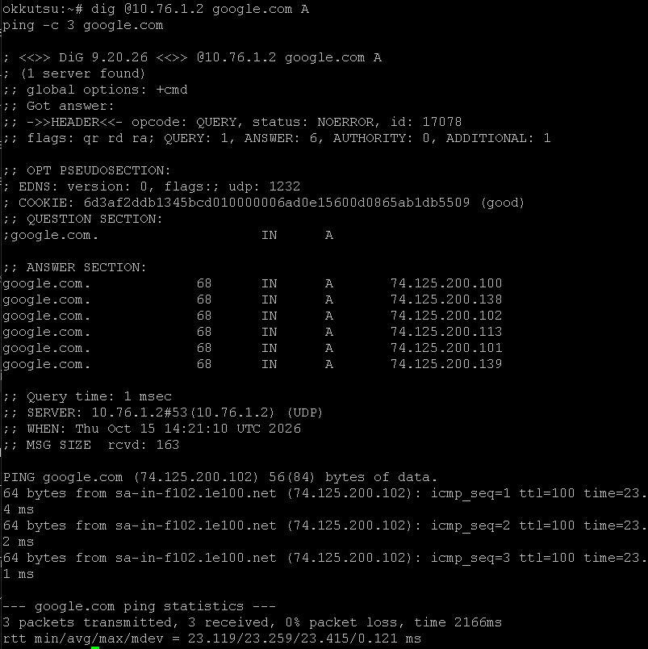

### Troubleshooting

#### DNS lokal berhasil, tetapi `google.com` menghasilkan `REFUSED`

Masalah ini ditemukan ketika pengujian dari Okkutsu. A record, CNAME, dan PTR berhasil, tetapi query ke domain internet ditolak.

Penyebabnya adalah Okkutsu menggunakan IP `10.76.2.70/24`, sedangkan konfigurasi awal Utahime hanya mengizinkan recursion dan cache query dari `10.76.1.0/24`.

**Solusi:** menambahkan `10.76.2.0/24` pada aturan `allow-recursion` dan `allow-query-cache`, lalu memvalidasi dan memuat ulang konfigurasi BIND.

#### DNS Forwarder tidak merespons

Forwarder diuji secara langsung menggunakan:

```bash
dig @192.168.122.1 google.com A
```

Jika query gagal, periksa rute jaringan Utahime dan konektivitas ke `192.168.122.1`.

#### Konfigurasi BIND tidak valid

Gunakan:

```bash
named-checkconf
named-checkzone jujutsu.k25.com /etc/bind/db.jujutsu.k25.com
named-checkzone 1.76.10.in-addr.arpa /etc/bind/db.10.76.1
```

Perbaiki error sebelum memuat ulang BIND.

#### Zona Slave belum tersedia

Periksa alamat master, izin zone transfer, konektivitas Shoko ke Utahime, serta status proses BIND. Pastikan konfigurasi zona pada master valid.

#### DNS berhasil tetapi ping gagal

Jika query `dig` berhasil tetapi ping gagal, periksa jalur jaringan dan kemungkinan pemblokiran ICMP. Kegagalan ping tidak selalu berarti layanan DNS bermasalah.

### Kesimpulan

Praktikum ini mengonfigurasi Utahime sebagai DNS Master dan Forwarder, Shoko sebagai DNS Slave, serta Okkutsu sebagai client. A record digunakan untuk mengarahkan `jujutsu.k25.com` ke `10.76.1.4`, CNAME menyediakan alias `www`, dan PTR memungkinkan pencarian nama domain berdasarkan IP.

DNS Forwarder diarahkan ke `192.168.122.1` agar permintaan ke domain di luar zona lokal dapat diteruskan. Kendala `REFUSED` yang ditemukan saat pengujian disebabkan subnet Okkutsu belum dimasukkan dalam aturan akses recursion dan cache. Setelah subnet `10.76.2.0/24` ditambahkan, resolusi DNS dari Okkutsu berhasil.

13. Kepala Sekolah Yaga dan Inumaki mendirikan database terpusat yang redundan agar log aktivitas kutukan tetap aman tersimpan. Konfigurasikan MariaDB pada yaga sebagai DB-Master dan inumaki sebagai DB-Slave. Buat database db_shibuya_<xxxx> beserta tabel request_logs di Master, aktifkan binary logging (log-bin, server-id), lalu hubungkan inumaki sebagai Slave yang menyalin data secara realtime dengan CHANGE MASTER TO. Berikan hak akses remote bagi seluruh node di Network 4, lalu buktikan replikasi berhasil dengan memasukkan data baru di Master dan memeriksa hasilnya di Slave.

### Pendahuluan
Konfigurasi Database MariaDB Master-Slave pada Jaringan GNS3
1. Mengonfigurasi MariaDB pada Yaga sebagai DB-Master.
2. Mengonfigurasi MariaDB pada Inumaki sebagai DB-Slave untuk mereplikasi data dari Master.
3. Membuat database `db_shibuya_K25` dan tabel `request_logs`
4. Mengaktifkan binary logging pada Master agar perubahan database dapat direplikasi.
5. Memberikan akses database kepada client di jaringan yang ditentukan.
6. Menguji koneksi client ke database dan memastikan data dapat direplikasi dari Master ke Slave.
2. Topologi dan alamat IP

| Node | Peran | Alamat IP |
| - | - | - |
| Yaga | MariaDB Master | 10.76.4.9/24 |
| Inumaki | MariaDB Slave | 10.76.4.8/24 |
| Ino | Client | 10.76.3.11/24 |
| Kugisaki | Client | 10.76.3.99/24 |
| Kusakabe | Client | 10.76.3.14/24 |
| Miwa | Client | 10.76.3.100/24 |
| Shoko | DNS | 10.76.1.3 |

Database yang digunakan adalah `db_shibuya_K25`, dengan tabel `request_logs`. Akun replicator digunakan oleh Slave untuk mengambil perubahan dari Master, sedangkan `dbuser` digunakan oleh client untuk mengakses database.


### Konfigurasi DB-Master pada Yaga
Instalasi MariaDB

Jalankan perintah berikut pada Yaga yang menggunakan Debian:
```bash
apt-get update
apt-get install -y mariadb-server mariadb-client
```

Konfigurasi binary logging

Buat file konfigurasi:
```bash
cat > /etc/mysql/mariadb.conf.d/60-replication.cnf <<'EOF'
[mysqld]
server-id = 1
log_bin = /var/log/mysql/mariadb-bin
binlog_format = ROW
bind-address = 0.0.0.0
EOF
```

Siapkan direktori log dan runtime sebelum menjalankan ulang MariaDB:
```bash
mkdir -p /var/log/mysql /run/mysqld
chown mysql:mysql /var/log/mysql /run/mysqld
chmod 750 /var/log/mysql
chmod 755 /run/mysqld

service mariadb restart
```

Penjelasan konfigurasi:
- server-id = 1: memberikan ID unik kepada server Master.
- log_bin: mengaktifkan pencatatan perubahan database ke binary log.
- binlog_format = ROW: mencatat perubahan berdasarkan baris data.
- bind-address = 0.0.0.0: memungkinkan MariaDB menerima koneksi melalui seluruh antarmuka jaringan IPv4, dengan tetap bergantung pada izin akun dan kontrol jaringan.

Verifikasi binary logging:
```bash
SHOW VARIABLES LIKE 'log_bin';
SHOW MASTER STATUS\G
```

Nilai `log_bin` harus ON. Perintah `SHOW MASTER STATUS` menampilkan nama file binary log dan posisi log yang diperlukan ketika mengonfigurasi Slave.

Membuat database, tabel, dan akun

Jalankan pada MariaDB Yaga:
```bash
CREATE DATABASE IF NOT EXISTS db_shibuya_K25;

CREATE TABLE IF NOT EXISTS db_shibuya_K25.request_logs (
    id BIGINT AUTO_INCREMENT PRIMARY KEY,
    source_node VARCHAR(100) NOT NULL,
    request_detail TEXT NOT NULL,
    created_at TIMESTAMP DEFAULT CURRENT_TIMESTAMP
);
```

Buat akun untuk replikasi dan akses client:
```bash
CREATE USER IF NOT EXISTS 'replicator'@'10.76.4.8'
IDENTIFIED BY 'replicatorK25';

GRANT REPLICATION SLAVE ON *.*
TO 'replicator'@'10.76.4.8';

CREATE USER IF NOT EXISTS 'dbuser'@'10.76.3.%'
IDENTIFIED BY 'databaseK25';

CREATE USER IF NOT EXISTS 'dbuser'@'10.76.4.%'
IDENTIFIED BY 'databaseK25';

GRANT ALL PRIVILEGES ON db_shibuya_K25.*
TO 'dbuser'@'10.76.3.%';

GRANT ALL PRIVILEGES ON db_shibuya_K25.*
TO 'dbuser'@'10.76.4.%';

FLUSH PRIVILEGES;
```

Akun dbuser diizinkan mengakses database dari alamat yang cocok dengan subnet `10.76.3.%` dan `10.76.4.%`.
Verifikasi tabel:
```bash
DESCRIBE db_shibuya_K25.request_logs;
```

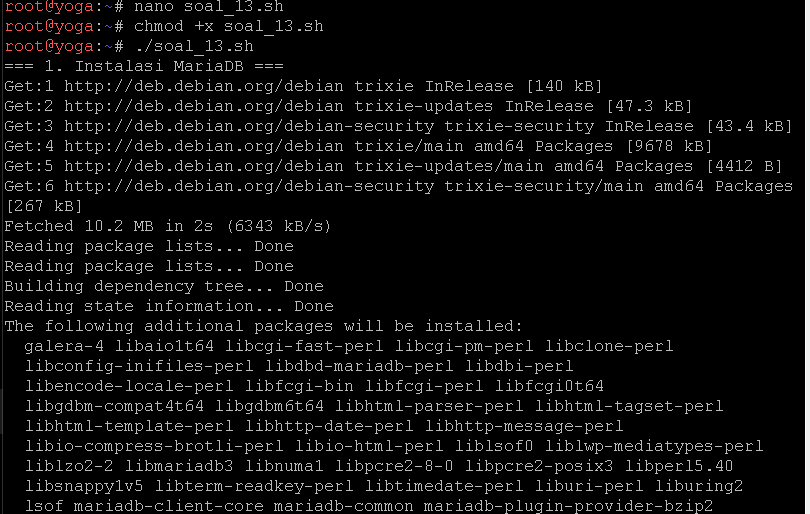

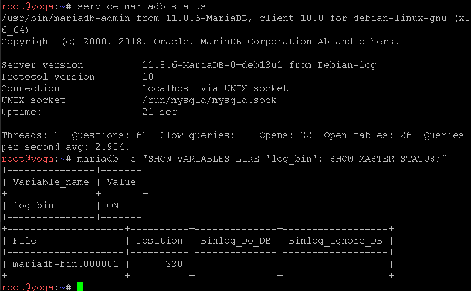

### Konfigurasi DB-Slave pada Inumaki
Instalasi MariaDB

Jalankan pada Inumaki:
```bash
apt-get update
apt-get install -y mariadb-server mariadb-client
```

Konfigurasi server Slave

Buat file konfigurasi:
```bash
cat > /etc/mysql/mariadb.conf.d/60-replication.cnf <<'EOF'
[mysqld]
server-id = 2
relay_log = /var/log/mysql/mariadb-relay-bin
read_only = ON
bind-address = 0.0.0.0
EOF
```

Siapkan direktori dan restart MariaDB:
```bash
mkdir -p /var/log/mysql /run/mysqld
chown mysql:mysql /var/log/mysql /run/mysqld
chmod 750 /var/log/mysql
chmod 755 /run/mysqld

service mariadb restart
```

Penjelasan:
- server-id = 2: ID unik bagi server Slave, berbeda dari Master.
- relay_log: menyimpan perubahan yang diterima dari Master sebelum diterapkan pada database Slave.
- read_only = ON: membantu mencegah perubahan langsung oleh akun biasa pada server Slave.

Menghubungkan Slave ke Master

Pertama, ambil nilai terbaru dari Yaga:
```bash
SHOW MASTER STATUS\G
```

Catat File dan Position. Nilainya bisa berubah, sehingga harus menggunakan hasil aktual saat konfigurasi replikasi dilakukan.
Pada Inumaki, masuk ke MariaDB:
```bash
mariadb
```

Untuk konfigurasi awal, jalankan perintah berikut dengan mengganti nilai file dan posisi sesuai hasil dari Yaga:
```bash
STOP SLAVE;

CHANGE MASTER TO
    MASTER_HOST = '10.76.4.9',
    MASTER_USER = 'replicator',
    MASTER_PASSWORD = 'replicatorK25',
    MASTER_PORT = 3306,
    MASTER_LOG_FILE = 'mariadb-bin.000003',
    MASTER_LOG_POS = 1720,
    MASTER_CONNECT_RETRY = 10;

START SLAVE;
```
STOP SLAVE;

CHANGE MASTER TO
    MASTER_HOST = '10.76.4.9',
    MASTER_USER = 'replicator',
    MASTER_PASSWORD = 'replicatorK25',
    MASTER_PORT = 3306,
    MASTER_LOG_FILE = 'GANTI_FILE_DARI_YAGA',
    MASTER_LOG_POS = GANTI_POSITION_DARI_YAGA,
    MASTER_CONNECT_RETRY = 10;

START SLAVE;

Periksa status replikasi:
```bash
SHOW SLAVE STATUS\G
```

Indikator keberhasilan:
```bash
Slave_IO_Running: Yes
Slave_SQL_Running: Yes
```

`Slave_IO_Running`: Yes menunjukkan Slave dapat menerima binary log dari Master. `Slave_SQL_Running`: Yes menunjukkan proses SQL pada Slave berjalan untuk menerapkan perubahan yang diterima.

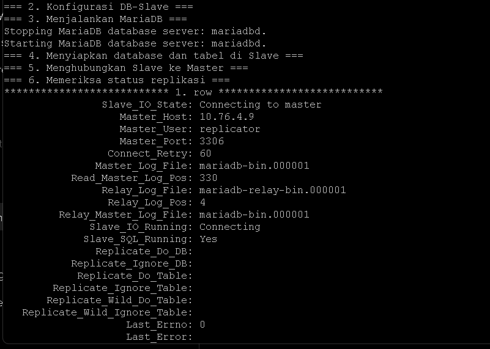

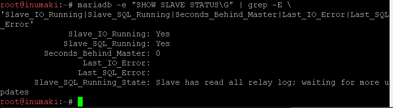

### Pengujian replikasi data
Pada Yaga, masukkan data uji:
```bash
INSERT INTO db_shibuya_K25.request_logs
    (source_node, request_detail)
VALUES
    ('Yaga', 'Pengujian replikasi Soal 13');
```

Kemudian, pada Inumaki ketikkan command ini:
```bash
SELECT *
FROM db_shibuya_K25.request_logs
ORDER BY id DESC
LIMIT 5;
```

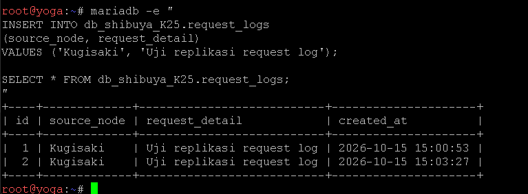

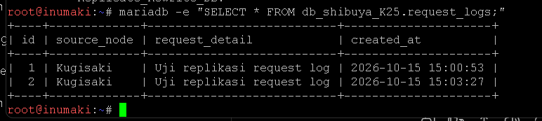

### Konfigurasi akses database dari client
Instalasi client pada Alpine Linux
```bash
apk update
apk add mariadb-client
```

Menghubungkan Ino ke Yaga

Dari terminal Ino (10.76.3.11), jalankan:
```bash
mariadb -h 10.76.4.9 -u dbuser -p db_shibuya_K25
```

Setelah memasukkan password dbuser, uji akses:
```bash
SELECT * FROM request_logs;
```

Pada pengujian yang sudah dilakukan, Ino berhasil mengakses tabel request_logs pada database Master.

Memberikan akses kepada client lain

Pada Yaga, akun `dbuser` telah dikonfigurasi untuk host yang cocok dengan subnet `10.76.3.%` dan `10.76.4.%`. Client lain pada cakupan jaringan tersebut dapat mencoba koneksi dengan perintah yang sama:
```bash
mariadb -h 10.76.4.9 -u dbuser -p db_shibuya_K25
```

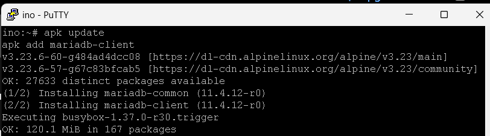

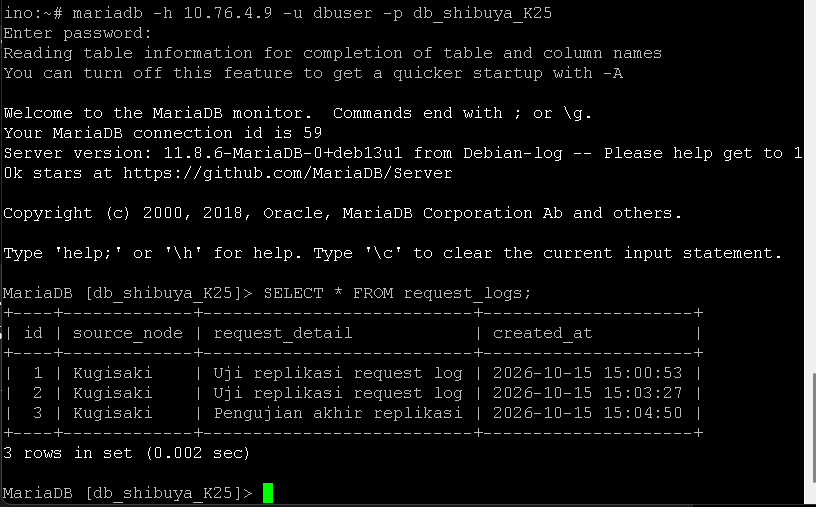


### Kesimpulan
Soal ini menerapkan MariaDB Master-Slave pada jaringan GNS3. Yaga berfungsi sebagai server database utama dan Inumaki sebagai server replikasi. Database dan tabel berhasil disiapkan, dan client Ino berhasil mengakses tabel `request_logs` pada Master. Konfigurasi ini menunjukkan bagaimana replikasi database dan pengaturan hak akses client dapat diterapkan pada jaringan terdistribusi.

14. Para penyihir lapangan bersiaga di Data Center sebagai pekerja backend untuk memproses aplikasi. Pasang Nginx dan PHP-FPM pada maki dan panda untuk menyajikan web frontend yang menampilkan hostname masing-masing. Pada nanami, todo, dan kirara, siapkan layanan API yang mencatat log request ke database yaga. Konfigurasikan virtual host agar worker merespons domain layanan yang ditentukan. Batasi akses langsung dari klien ke worker, web worker hanya menerima trafik melalui jalur proxy web yang ditentukan, sedangkan worker API hanya menerima trafik melalui geto. Uji bahwa akses langsung dari klien ditolak, sementara akses melalui reverse proxy tetap berhasil.

### Pendahuluan

1. Mengonfigurasi web server menggunakan Nginx dan PHP-FPM pada frontend worker.
2. Mengonfigurasi layanan API pada beberapa API worker.
3. Menerapkan reverse proxy dan load balancing menggunakan Nginx.
4. Menghubungkan API worker dengan database MariaDB untuk mencatat request.
5. Menerapkan pembatasan akses langsung ke worker agar hanya dapat diakses melalui proxy yang ditentukan.
6. Menguji distribusi request dan mekanisme failover pada API worker.

### Topologi dan Alamat IP

| Node | Alamat IP | Peran |
|---|---|---|
| Gojo | `10.76.1.4` | Public Reverse Proxy |
| Geto | `10.76.4.2` | Internal Load Balancer |
| Panda | `10.76.4.4` | Frontend Worker |
| Nanami | `10.76.4.5` | API Worker Utama |
| Todo | `10.76.4.6` | API Worker Utama |
| Kirara | `10.76.4.7` | API Worker Cadangan |
| Maki (hostname mesin: `inumaki`) | `10.76.4.8` | Frontend Worker |
| Yaga | `10.76.4.9` | MariaDB Master |

Database yang digunakan adalah `db_shibuya_K25`, dengan tabel `request_logs` untuk menyimpan catatan request yang diterima oleh API worker.

### Konfigurasi Frontend Worker

Konfigurasi frontend dilakukan pada Panda dan Maki menggunakan Nginx dan PHP-FPM. PHP digunakan untuk menampilkan hostname mesin sehingga setiap worker dapat dibedakan ketika diakses.

File halaman utama dibuat pada direktori `/var/www/html/index.php`. Contoh kode PHP yang digunakan untuk menampilkan hostname adalah:

```php
<?php
echo gethostname();
?>
```

Nginx dikonfigurasi agar dapat memproses file PHP melalui PHP-FPM menggunakan socket:

```nginx
fastcgi_pass unix:/run/php/php8.4-fpm.sock;
```

Dengan konfigurasi tersebut, request ke halaman utama akan diproses oleh PHP-FPM dan menghasilkan hostname worker yang melayani request.

Hasil pengujian menunjukkan bahwa Panda menampilkan hostname `panda`, sedangkan mesin Maki menampilkan hostname `inumaki`.

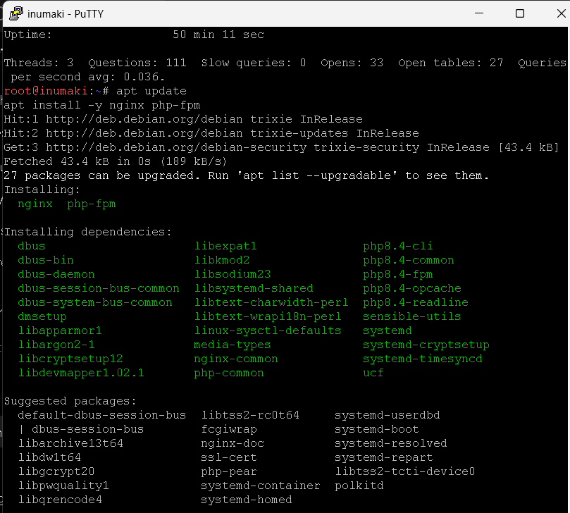

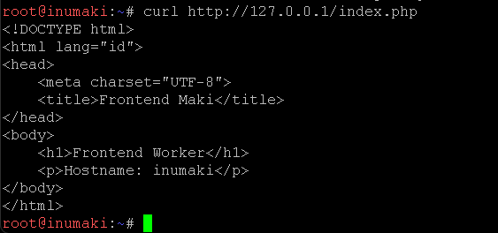

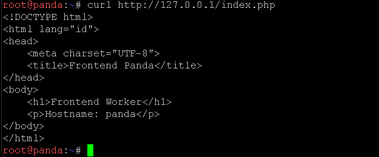


### Konfigurasi Public Reverse Proxy pada Gojo

Gojo dikonfigurasi menggunakan Nginx sebagai public reverse proxy. Reverse proxy menerima request berdasarkan domain, kemudian meneruskannya ke frontend worker yang sesuai.

Konfigurasi untuk Panda:

```nginx
server {
    listen 80;
    server_name panda.jujutsu.k25.com;

    location / {
        proxy_pass http://10.76.4.4;
        proxy_set_header Host $host;
        proxy_set_header X-Real-IP $remote_addr;
        proxy_set_header X-Forwarded-For $proxy_add_x_forwarded_for;
    }
}
```

Konfigurasi untuk Maki:

```nginx
server {
    listen 80;
    server_name maki.jujutsu.k25.com;

    location / {
        proxy_pass http://10.76.4.8;
        proxy_set_header Host $host;
        proxy_set_header X-Real-IP $remote_addr;
        proxy_set_header X-Forwarded-For $proxy_add_x_forwarded_for;
    }
}
```

Setiap domain diarahkan ke alamat IP frontend worker masing-masing. Header `X-Real-IP` dan `X-Forwarded-For` digunakan untuk meneruskan informasi alamat IP client kepada server tujuan.

Konfigurasi diperiksa menggunakan:

```bash
nginx -t
```

Pengujian menggunakan request dengan header `Host` menunjukkan bahwa Gojo berhasil meneruskan request ke Panda dan Maki dengan respons HTTP `200 OK`.


### Konfigurasi API Worker

API worker terdiri dari Nanami, Todo, dan Kirara. Ketiganya menggunakan Nginx, PHP-FPM, dan ekstensi PHP untuk koneksi MySQL/MariaDB.

Aplikasi API ditempatkan pada direktori `/var/www/api/index.php`. Endpoint tersebut mengambil informasi request, seperti hostname worker, metode HTTP, URI, dan alamat IP client. Informasi tersebut kemudian dikirimkan ke database MariaDB pada Yaga.

Koneksi database menggunakan parameter berikut:

- Host database: `10.76.4.9`
- Nama database: `db_shibuya_K25`
- Nama tabel: `request_logs`
- Pengguna database: `api_logger`

Setiap request yang berhasil diproses akan dicatat pada tabel `request_logs`. Respons API berbentuk JSON, misalnya:

```json
{
  "status": "success",
  "worker": "nanami",
  "message": "Request berhasil dicatat"
}
```

Nilai `worker` menyesuaikan dengan mesin yang memproses request. Dengan demikian, respons dapat digunakan untuk mengidentifikasi API worker yang sedang melayani request.

Pengujian langsung terhadap API worker menunjukkan bahwa ketiga worker dapat memberikan respons JSON dengan status berhasil dan mencatat request ke database.


### Konfigurasi Internal Load Balancer pada Geto

Geto dikonfigurasi sebagai internal load balancer menggunakan Nginx. Load balancer meneruskan request menuju API worker berdasarkan konfigurasi upstream.

Konfigurasi upstream yang digunakan:

```nginx
upstream api_workers {
    server 10.76.4.5:80;
    server 10.76.4.6:80;
    server 10.76.4.7:80 backup;
}
```

Nanami dan Todo berfungsi sebagai worker utama, sedangkan Kirara ditetapkan sebagai worker cadangan melalui parameter `backup`.

Virtual host API dikonfigurasi sebagai berikut:

```nginx
server {
    listen 80;
    server_name api.jujutsu.k25.com;

    location / {
        proxy_pass http://api_workers;
        proxy_set_header Host $host;
        proxy_set_header X-Real-IP $remote_addr;
        proxy_set_header X-Forwarded-For $proxy_add_x_forwarded_for;
    }
}
```

Konfigurasi tersebut membuat request menuju `api.jujutsu.k25.com` diteruskan ke upstream `api_workers`. Header forwarding juga digunakan untuk meneruskan informasi request.

Hasil pengujian menunjukkan bahwa request normal dilayani oleh Nanami dan Todo. Ketika layanan Nginx pada kedua worker utama dihentikan sementara untuk pengujian, request berhasil dialihkan ke Kirara sebagai worker cadangan.


### Konfigurasi Keamanan Akses Worker

Pembatasan akses langsung diterapkan pada frontend worker dan API worker menggunakan firewall `nftables`.

Aturan firewall dibuat untuk mengizinkan koneksi HTTP dari proxy yang sesuai dan menolak koneksi HTTP langsung dari sumber lain.

| Jenis Worker | Proxy yang Diizinkan | IP Proxy |
|---|---|---|
| Frontend worker | Gojo | `10.76.1.4` |
| API worker | Geto | `10.76.4.2` |

Aturan firewall mencakup izin untuk koneksi yang sudah terbentuk dan loopback, izin HTTP dari proxy yang ditentukan, serta penolakan koneksi TCP port 80 dari sumber lain.

Aturan disimpan pada `/etc/nftables.conf` agar dapat dimuat kembali. Pada lingkungan DebiNet, skrip inisialisasi juga disiapkan untuk memuat aturan firewall ketika container dijalankan kembali.

Pengujian dari client Okkutsu menunjukkan bahwa akses HTTP langsung ke worker mengalami timeout setelah aturan firewall diterapkan. Sementara itu, akses melalui Gojo untuk frontend dan Geto untuk API tetap berhasil.

Hasil tersebut menunjukkan bahwa akses worker dibatasi sesuai peran proxy masing-masing.


### Pengujian dan Hasil

Pengujian dilakukan pada layanan frontend, API, load balancing, pencatatan database, dan pembatasan akses.

| No. | Pengujian | Hasil |
|---|---|---|
| 1 | Akses frontend Panda melalui Gojo | Berhasil, respons `200 OK` |
| 2 | Akses frontend Maki melalui Gojo | Berhasil, respons `200 OK` |
| 3 | Menampilkan hostname frontend | Berhasil, hostname worker ditampilkan |
| 4 | Request langsung ke API worker | Berhasil memberikan respons JSON |
| 5 | Request API melalui Geto | Berhasil, dilayani Nanami atau Todo |
| 6 | Pencatatan request ke MariaDB Yaga | Berhasil, data tercatat pada `request_logs` |
| 7 | Pengujian failover API | Berhasil, Kirara melayani request ketika worker utama dihentikan |
| 8 | Akses langsung ke worker setelah firewall diterapkan | Ditolak atau mengalami timeout |
| 9 | Akses frontend dan API melalui proxy setelah firewall diterapkan | Berhasil |

Hasil tersebut memperlihatkan bahwa masing-masing komponen dapat menjalankan fungsinya sesuai konfigurasi. Reverse proxy menjadi jalur akses menuju frontend, load balancer mendistribusikan request ke API worker, database menyimpan log request, dan firewall membatasi akses langsung ke worker.


### Kendala dan Penyelesaian

#### PHP Tidak Diproses oleh Web Server

Pada pengujian awal, kode PHP sempat tampil sebagai teks biasa karena layanan PHP-FPM belum berjalan sebagaimana mestinya.

**Penyelesaian:** PHP-FPM dijalankan dan konfigurasi Nginx diarahkan ke socket PHP-FPM versi 8.4. Setelah itu, halaman PHP dapat menampilkan hostname worker.

#### Akses Langsung ke Worker Masih Terbuka

Sebelum firewall diterapkan, request langsung dari client ke worker masih mendapatkan respons HTTP `200 OK`.

**Penyelesaian:** Aturan `nftables` diterapkan untuk mengizinkan HTTP hanya dari alamat IP proxy yang sesuai dan menolak akses langsung dari sumber lainnya.

#### Pengujian Worker Cadangan

Pada kondisi normal, request hanya terlihat dilayani oleh Nanami dan Todo karena Kirara ditetapkan sebagai worker cadangan.

**Penyelesaian:** Layanan Nginx pada Nanami dan Todo dihentikan sementara untuk simulasi kegagalan. Setelah itu, Geto berhasil meneruskan request ke Kirara.

### Kesimpulan

Soal ini berhasil menerapkan arsitektur layanan web yang terdiri dari frontend worker, API worker, public reverse proxy, internal load balancer, dan database logging. Gojo meneruskan request ke frontend worker, sedangkan Geto meneruskan request API ke Nanami, Todo, dan Kirara sebagai worker cadangan. Request yang diproses API berhasil dicatat pada database MariaDB di Yaga. Firewall `nftables` juga berhasil membatasi akses langsung ke worker tanpa mengganggu akses melalui proxy. Dengan konfigurasi tersebut, layanan memiliki pemisahan peran, pencatatan request, mekanisme failover, dan pembatasan akses jaringan.

15. Geto bertugas mengendalikan pembagian beban request API di internal Data Center agar server tidak tumbang bersamaan. Konfigurasikan Nginx pada geto sebagai Load Balancer internal dengan upstream api_cluster yang mengarahkan trafik ke nanami dan todo. Terapkan algoritma Weighted Round Robin dengan bobot 3:1, di mana nanami menerima porsi beban tiga kali lebih banyak daripada todo. Buktikan distribusi beban ini dengan melakukan loop request berulang kali ke geto dari jaringan lokal Data Center dan periksa rasio responnya.

### Pendahuluan

1. Mengonfigurasi Nginx pada Geto sebagai internal load balancer untuk layanan API.
2. Menerapkan algoritma Weighted Round Robin dengan bobot 3:1 antara Nanami dan Todo.
3. Menguji distribusi request API melalui Geto menggunakan request berulang.
4. Membuktikan rasio pembagian beban berdasarkan jumlah respons dari masing-masing API worker.

### Topologi dan Alamat IP

| Node | Alamat IP | Peran |
|---|---|---|
| Geto | `10.76.4.2` | Internal Load Balancer |
| Nanami | `10.76.4.5` | API Worker Utama |
| Todo | `10.76.4.6` | API Worker Utama |

Load balancer pada Geto menerima request API dan meneruskannya ke Nanami atau Todo sesuai bobot yang telah ditentukan.

### Konfigurasi Nginx pada Geto

Konfigurasi load balancer dibuat pada file `/etc/nginx/sites-available/api-proxy`. Pada bagian upstream, digunakan nama `api_cluster` dengan bobot 3 untuk Nanami dan bobot 1 untuk Todo.

```nginx
upstream api_cluster {
    server 10.76.4.5:80 weight=3;
    server 10.76.4.6:80 weight=1;
}

server {
    listen 80;
    server_name api.jujutsu.k25.com;

    location / {
        proxy_pass http://api_cluster;
        proxy_set_header Host $host;
        proxy_set_header X-Real-IP $remote_addr;
        proxy_set_header X-Forwarded-For $proxy_add_x_forwarded_for;
    }
}
```

Parameter `weight=3` membuat Nanami memperoleh bobot distribusi tiga kali lebih besar daripada Todo yang menggunakan `weight=1`.

Dengan konfigurasi tersebut, Nginx menggunakan Weighted Round Robin untuk membagikan request ke kedua API worker berdasarkan bobotnya.


### Penerapan Konfigurasi

Setelah konfigurasi disimpan, dilakukan pemeriksaan sintaks Nginx menggunakan perintah:

```bash
nginx -t
```

Jika konfigurasi valid, perubahan diterapkan dengan:

```bash
nginx -s reload
```

Pemeriksaan ini dilakukan untuk memastikan konfigurasi dapat digunakan sebelum pengujian distribusi request dilakukan.

### Pengujian Distribusi Request

Pengujian dilakukan dengan mengirimkan 40 request secara berulang ke Nginx pada Geto. Request dikirim melalui alamat lokal Geto dengan header `Host` yang sesuai.

```bash
for i in $(seq 1 40); do
    curl -s http://127.0.0.1/ \
        -H 'Host: api.jujutsu.k25.com'
    echo
done
```

Setiap API worker memberikan respons JSON yang mencantumkan hostname worker pada field `worker`. Informasi tersebut digunakan untuk mengetahui worker yang melayani setiap request.

Hasil pengujian kemudian dihitung menggunakan:

```bash
for i in $(seq 1 40); do
    curl -s http://127.0.0.1/ \
        -H 'Host: api.jujutsu.k25.com'
    echo
done | grep -o '"worker":"[^"]*"' | sort | uniq -c
```

Perintah tersebut mengirim 40 request, mengambil nilai hostname dari respons JSON, lalu menghitung jumlah respons dari masing-masing worker.


### Hasil Pengujian

Bobot 3:1 berarti Nanami mendapatkan sekitar 75% request dan Todo sekitar 25% request ketika kedua worker sehat dan seluruh request berhasil diproses.

Berdasarkan pengujian yang telah dilakukan, konfigurasi Weighted Round Robin pada Geto berhasil diterapkan dan request berhasil didistribusikan ke Nanami serta Todo sesuai pengaturan bobot.

## 9. Kesimpulan

Soal ini berhasil menerapkan Nginx pada Geto sebagai internal load balancer menggunakan algoritma Weighted Round Robin. Upstream `api_cluster` mengarahkan request ke Nanami dengan bobot 3 dan Todo dengan bobot 1. Pengujian request berulang digunakan untuk memeriksa distribusi respons kedua worker. Konfigurasi ini memungkinkan pembagian beban API berdasarkan bobot yang ditentukan sehingga beban tidak hanya diarahkan ke satu server.

16. Gojo berdiri di perbatasan DMZ sebagai gerbang publik tunggal bagi seluruh client dari luar maupun dalam. Konfigurasikan Nginx pada gojo untuk melayani domain jujutsu.<xxxx>.com dan www.jujutsu.<xxxx>.com menggunakan metode Path-Based Routing. Atur agar request root (/) diteruskan secara Round Robin ke worker frontend (maki dan panda), sedangkan request ke path /api diteruskan langsung ke geto. Uji dari client Divisi A atau B bahwa akses ke web utama dibalas oleh Maki/Panda, sedangkan akses ke /api diteruskan dan dijawab oleh Nanami/Todo.

### Pendahuluan

Mengimplementasikan Path-Based Routing menggunakan Nginx pada Gojo sebagai reverse proxy. Permintaan ke path `/` diarahkan ke worker frontend Maki dan Panda, sedangkan permintaan ke path `/api` diarahkan ke Geto untuk diteruskan ke worker API Nanami dan Todo.

### Konfigurasi

Script pada Gojo

Script dijalankan pada Gojo (`10.76.1.4`) untuk membuat konfigurasi Nginx yang mengatur routing berdasarkan path URL.

```bash
#!/bin/sh
set -eu

mkdir -p /etc/nginx/sites-available /etc/nginx/sites-enabled

cat > /etc/nginx/sites-available/jujutsu-routing <<'EOF'
upstream frontend_workers {
    server 10.76.4.8:80;
    server 10.76.4.4:80;
}

server {
    listen 80;
    server_name jujutsu.k25.com www.jujutsu.k25.com;

    location = /api {
        proxy_pass http://10.76.4.2/;
        proxy_set_header Host api.jujutsu.k25.com;
        proxy_set_header X-Real-IP $remote_addr;
        proxy_set_header X-Forwarded-For $proxy_add_x_forwarded_for;
    }

    location ^~ /api/ {
        proxy_pass http://10.76.4.2/;
        proxy_set_header Host api.jujutsu.k25.com;
        proxy_set_header X-Real-IP $remote_addr;
        proxy_set_header X-Forwarded-For $proxy_add_x_forwarded_for;
    }

    location / {
        proxy_pass http://frontend_workers;
        proxy_set_header Host $host;
        proxy_set_header X-Real-IP $remote_addr;
        proxy_set_header X-Forwarded-For $proxy_add_x_forwarded_for;
    }
}
EOF

ln -sf /etc/nginx/sites-available/jujutsu-routing \
       /etc/nginx/sites-enabled/jujutsu-routing

nginx -t
nginx -s reload
```

#### Perubahan DNS pada Shoko

Shoko (`10.76.1.3`) juga diperbarui agar klien Okkutsu dari subnet `10.76.2.0/24` diizinkan melakukan query DNS. Subnet tersebut ditambahkan pada `allow-query`, `allow-recursion`, dan `allow-query-cache` di `/etc/bind/named.conf.options`.

Setelah perubahan, konfigurasi diperiksa menggunakan `named-checkconf` dan dimuat ulang menggunakan `rndc reload`.

Perubahan ini diperlukan karena sebelumnya Shoko menolak query DNS dari Okkutsu. Record DNS tetap mengarahkan domain utama ke Gojo (`10.76.1.4`), sedangkan `www.jujutsu.k25.com` menggunakan CNAME ke domain utama.

### Pengujian dan Hasil

Pengujian dilakukan dari Okkutsu menggunakan `nslookup` dan `curl`.

#### Pengujian DNS

Perintah:

```bash
nslookup jujutsu.k25.com 10.76.1.3
nslookup www.jujutsu.k25.com 10.76.1.3
```

Hasil:

```bash
Server:         10.76.1.3
Address:        10.76.1.3#53

Name:   jujutsu.k25.com
Address: 10.76.1.4

Server:         10.76.1.3
Address:        10.76.1.3#53

www.jujutsu.k25.com canonical name = jujutsu.k25.com.
Name:   jujutsu.k25.com
Address: 10.76.1.4
```

Analisis: kedua domain berhasil di-resolve oleh DNS Shoko dan mengarah ke Gojo.


#### Pengujian path frontend `/`

Perintah:

```bash
curl -i http://jujutsu.k25.com/
```

Hasil:

```bash
HTTP/1.1 200 OK
Server: nginx
Content-Type: text/html; charset=UTF-8

<!DOCTYPE html>
<html lang="id">
<head>
    <meta charset="UTF-8">
    <title>Frontend Maki</title>
</head>
<body>
    <h1>Frontend Worker</h1>
    <p>Hostname: inumaki</p>
</body>
</html>
```

Analisis: permintaan ke `/` berhasil menghasilkan HTTP 200 OK dan halaman frontend Maki dengan hostname `inumaki`. Ini membuktikan permintaan root berhasil diteruskan ke worker frontend.


##### Pengujian path API `/api`

Perintah:

```bash
curl -i http://jujutsu.k25.com/api
```

Hasil:

```bash
HTTP/1.1 200 OK
Server: nginx
Content-Type: application/json; charset=UTF-8

{"status":"success","worker":"nanami","message":"Request berhasil dicatat"}
```

Analisis: permintaan `/api` berhasil menghasilkan HTTP 200 OK dan respons JSON dari worker Nanami. Ini menunjukkan permintaan API berhasil diteruskan melalui Geto ke backend API.


#### Pengujian domain `www`

Perintah:

```bash
curl -i http://www.jujutsu.k25.com/
curl -i http://www.jujutsu.k25.com/api
```

Hasil utama:

```bash
# http://www.jujutsu.k25.com/
HTTP/1.1 200 OK
<title>Frontend Maki</title>
<p>Hostname: inumaki</p>

# http://www.jujutsu.k25.com/api
HTTP/1.1 200 OK
{"status":"success","worker":"todo","message":"Request berhasil dicatat"}
```

Analisis: domain `www` juga berhasil melayani kedua path. Path `/` memberikan halaman frontend, sedangkan `/api` memberikan respons JSON dari Todo.


### Kesimpulan

Konfigurasi Path-Based Routing pada Gojo berhasil diterapkan dan diuji dari Okkutsu. DNS untuk domain utama dan `www` mengarah ke Gojo. Permintaan ke `/` berhasil menuju worker frontend, sedangkan `/api` berhasil diteruskan ke Geto dan menghasilkan respons dari worker API.

Pengujian membuktikan bahwa kedua jalur dapat diakses dengan status HTTP 200 OK. Hasil Nanami dan Todo juga menunjukkan bahwa kedua worker API dapat melayani permintaan. Namun, untuk membuktikan Round Robin frontend antara Maki dan Panda serta rasio load balancing API 3:1, diperlukan pengujian permintaan berulang.

17. Komando pusat perlu mengetahui IP asli klien yang mengirimkan request tanpa tertukar dengan IP proxy perantara. Konfigurasikan gojo dan geto agar meneruskan informasi alamat klien melalui header X-Real-IP dan X-Forwarded-For. Pastikan geto hanya mempercayai informasi alamat klien yang diterima dari proxy terpercaya, dan skrip API menyimpan alamat klien yang telah diverifikasi ke kolom client_ip pada tabel request_logs di database yaga. Uji dengan mengirimkan request dari klien Network 2 dan Network 3 ke endpoint /api, kemudian periksa database untuk memastikan alamat yang tercatat sesuai dengan IP klien asal, bukan IP gojo atau geto.

### Pendahuluan

Mengonfigurasi Gojo dan Geto agar meneruskan alamat IP asli klien melalui header `X-Real-IP` dan `X-Forwarded-For`, memastikan Geto hanya mempercayai proxy yang tepercaya, serta menyimpan alamat IP klien yang telah diverifikasi ke kolom `client_ip` pada tabel `request_logs` di database Yaga.

### Topologi dan Node yang Digunakan

| Node | IP Address | Peran |
|---|---|---|
| Okkutsu | `10.76.2.70` | Klien Network 2 |
| Ino | `10.76.3.11` | Klien Network 3 |
| Gojo | `10.76.1.4` | Reverse proxy utama |
| Geto | `10.76.4.2` | Load balancer API |
| Nanami | `10.76.4.5` | API worker |
| Todo | `10.76.4.6` | API worker |
| Yaga | `10.76.4.9` | Database server |

### Konfigurasi

#### Gojo — Penerusan Header IP

Gojo dikonfigurasi untuk meneruskan informasi alamat klien menggunakan header `X-Real-IP` dan `X-Forwarded-For` pada lokasi `/api` dan `/api/`.

```nginx
proxy_set_header X-Real-IP $remote_addr;
proxy_set_header X-Forwarded-For $proxy_add_x_forwarded_for;
```

`X-Real-IP` berisi alamat IP peer yang terhubung langsung ke Gojo, sedangkan `X-Forwarded-For` meneruskan rantai alamat IP yang tercatat selama request melewati proxy.

#### Geto — Mempercayai Proxy Tepercaya

Geto dikonfigurasi agar hanya mempercayai header `X-Forwarded-For` dari Gojo menggunakan `set_real_ip_from`. Setelah alamat klien diverifikasi, Geto meneruskan alamat tersebut ke API worker.

```nginx
set_real_ip_from 10.76.1.4;
real_ip_header X-Forwarded-For;
real_ip_recursive on;
```

Header yang diteruskan Geto ke API worker:

```nginx
proxy_set_header X-Real-IP $remote_addr;
proxy_set_header X-Forwarded-For $remote_addr;
```

Konfigurasi load balancing API tetap menggunakan Nanami dan Todo dengan bobot 3:1.


#### Nanami dan Todo — Validasi IP Klien

Skrip PHP pada API worker memeriksa alamat koneksi langsung melalui `REMOTE_ADDR`. Header `X-Real-IP` hanya digunakan jika koneksi langsung berasal dari Geto (`10.76.4.2`) dan nilai header merupakan alamat IP yang valid.

```php
$peer = $_SERVER['REMOTE_ADDR'] ?? 'unknown';
$headerIp = $_SERVER['HTTP_X_REAL_IP'] ?? '';

if (
    $peer === '10.76.4.2' &&
    filter_var($headerIp, FILTER_VALIDATE_IP)
) {
    $client = $headerIp;
} else {
    $client = $peer;
}
```

Alamat IP yang telah diverifikasi disimpan dalam kolom `client_ip`, sementara informasi metode HTTP, URI, dan alamat IP juga dicatat dalam `request_detail`.


#### Yaga — Penyimpanan IP Klien

Kolom `client_ip` ditambahkan ke tabel `request_logs` dengan tipe data `VARCHAR(45)` agar dapat menyimpan alamat IPv4 maupun IPv6.

Query yang digunakan oleh API untuk mencatat request:

```sql
INSERT INTO request_logs
(source_node, request_detail, client_ip)
VALUES (:hostname, :detail, :client_ip);
```

Pemeriksaan struktur tabel dilakukan menggunakan:

```sql
DESCRIBE request_logs;
```


### Pengujian

Pengujian dilakukan dengan mengirimkan request ke endpoint `/api` melalui Gojo.

Perintah yang digunakan pada klien:

```bash
curl -i http://jujutsu.k25.com/api
```

Pengujian dilakukan dari Okkutsu pada Network 2 dan Ino pada Network 3. Hasil pencatatan diperiksa melalui database Yaga menggunakan query:

```sql
SELECT id, source_node, client_ip, request_detail, created_at
FROM request_logs
ORDER BY id DESC
LIMIT 10;
```


### Hasil Pengujian Database

Berdasarkan hasil query yang diperoleh, data berikut berhasil tercatat:

| ID | Source Node | Client IP | Request Detail |
|---:|---|---|---|
| 122 | nanami | `10.76.2.70` | `GET /`, client IP `10.76.2.70` |
| 123 | nanami | `10.76.3.11` | `GET /`, client IP `10.76.3.11` |

Hasil tersebut menunjukkan bahwa alamat IP kedua klien berhasil dicatat sesuai dengan alamat asalnya, bukan alamat IP Gojo (`10.76.1.4`) atau Geto (`10.76.4.2`).

Pemeriksaan sintaks PHP pada Nanami juga menghasilkan:

```text
No syntax errors detected in /var/www/api/index.php
```

Hasil ini menunjukkan bahwa sintaks skrip PHP pada Nanami valid. Pengujian yang sama pada Todo diperlukan untuk memastikan kedua API worker telah dikonfigurasi dengan benar.

### Kesimpulan

Konfigurasi penerusan dan validasi alamat IP klien berhasil diterapkan pada jalur request melalui Gojo dan Geto. Database Yaga berhasil mencatat alamat IP asli Okkutsu (`10.76.2.70`) dan Ino (`10.76.3.11`) pada kolom `client_ip`.

Dengan demikian, mekanisme pencatatan IP klien pada jalur API telah berhasil diuji untuk kedua jaringan. Validasi pada API worker Todo perlu dipastikan melalui pengujian tambahan apabila belum dilakukan.

18. nanami dan todo merupakan worker API utama, sedangkan kirara disiapkan sebagai worker cadangan. Konfigurasikan upstream api_cluster pada geto agar kirara menjadi server backup, serta terapkan passive health check dengan parameter max_fails=2 dan fail_timeout=5s pada worker API utama. Pastikan kirara menjalankan layanan API yang kompatibel dengan endpoint utama. Simulasikan gangguan dengan menghentikan layanan Nginx atau layanan API pada nanami dan todo. Buktikan dari klien bahwa request ke /api dialihkan ke kirara dan menghasilkan respons API yang valid tanpa error 502 Bad Gateway.

### Pendahuluan

Mengonfigurasi Kirara sebagai worker API cadangan pada Geto, menerapkan passive health check pada Nanami dan Todo menggunakan parameter `max_fails=2` dan `fail_timeout=5s`, serta menguji mekanisme failover ketika layanan API utama mengalami gangguan. Pengujian bertujuan memastikan request ke endpoint `/api` tetap mendapatkan respons API yang valid tanpa error `502 Bad Gateway`.

### Topologi dan Node yang Digunakan

| Node | IP Address | Peran |
|---|---|---|
| Okkutsu | `10.76.2.70` | Klien Network 2 |
| Ino | `10.76.3.11` | Klien Network 3 |
| Geto | `10.76.4.2` | Load balancer API |
| Nanami | `10.76.4.5` | API worker utama |
| Todo | `10.76.4.6` | API worker utama |
| Kirara | `10.76.4.7` | API worker cadangan |

### Konfigurasi

#### Konfigurasi Upstream pada Geto

Konfigurasi `api_cluster` pada Geto diperbarui dengan mempertahankan Nanami dan Todo sebagai worker utama serta menambahkan Kirara sebagai worker cadangan.

```nginx
upstream api_cluster {
    server 10.76.4.5:80 weight=3 max_fails=2 fail_timeout=5s;
    server 10.76.4.6:80 weight=1 max_fails=2 fail_timeout=5s;
    server 10.76.4.7:80 backup;
}
```

Keterangan konfigurasi:

- `weight=3` pada Nanami dan `weight=1` pada Todo mempertahankan pembagian beban kerja dengan bobot 3:1.
- `max_fails=2` menentukan jumlah kegagalan yang diperhitungkan sebelum worker dianggap tidak tersedia sementara.
- `fail_timeout=5s` menentukan periode penghitungan kegagalan sekaligus periode worker dianggap tidak tersedia.
- `backup` menetapkan Kirara sebagai worker cadangan yang digunakan ketika worker utama tidak tersedia.

Setelah konfigurasi diperbarui, dilakukan pemeriksaan dan pemuatan ulang Nginx menggunakan:

```bash
nginx -t && nginx -s reload
```


#### Persiapan Layanan API Kirara

Kirara dikonfigurasi agar menjalankan layanan API yang kompatibel dengan Nanami dan Todo. Layanan ini menerima request HTTP, memberikan respons dalam format JSON, serta mencatat request ke database Yaga.

Informasi yang dicatat mencakup hostname worker, metode HTTP, URI, dan alamat IP klien. Dengan demikian, Kirara dapat digunakan sebagai pengganti worker utama tanpa mengubah endpoint yang digunakan klien.

Pemeriksaan sintaks PHP dilakukan menggunakan:

```bash
php -l /var/www/api/index.php
```

Konfigurasi Nginx juga diperiksa menggunakan `nginx -t` sebelum layanan dimuat ulang.


#### Simulasi Gangguan

Simulasi dilakukan dengan menghentikan layanan Nginx pada worker utama menggunakan:

```bash
nginx -s stop
```

Gangguan diuji pada Nanami dan Todo secara terkontrol. Setelah kegagalan koneksi terdeteksi oleh Nginx Geto, request berikutnya seharusnya dialihkan ke Kirara apabila seluruh worker utama tidak tersedia.

Setelah pengujian selesai, layanan Nginx pada worker yang dihentikan dijalankan kembali menggunakan:

```bash
nginx
```


### Pengujian

Pengujian dilakukan dari klien dengan mengirimkan request ke endpoint `/api` melalui Gojo dan Geto.

Perintah yang digunakan:

```bash
curl -i http://jujutsu.k25.com/api
```

Pengujian dilakukan dalam dua kondisi:

1. **Kondisi normal:** Nanami dan Todo aktif sehingga request dilayani oleh worker utama sesuai mekanisme load balancing.
2. **Kondisi gangguan:** layanan worker utama dihentikan untuk menguji pengalihan request ke Kirara sebagai worker cadangan.

### Hasil yang Diharapkan

| Kondisi | Worker yang Melayani | Hasil |
|---|---|---|
| Nanami dan Todo aktif | Nanami atau Todo | Respons API normal |
| Salah satu worker utama gagal | Worker utama yang masih tersedia | Request tetap dilayani |
| Kedua worker utama tidak tersedia | Kirara | Respons API valid tanpa `502 Bad Gateway` |

Pada kondisi failover, respons JSON diharapkan menampilkan hostname `kirara` dan status `success`. Hal tersebut menunjukkan bahwa request berhasil diproses oleh worker cadangan.

### Kesimpulan

Konfigurasi failover API dilakukan dengan menetapkan Nanami dan Todo sebagai worker utama serta Kirara sebagai worker cadangan pada upstream `api_cluster` di Geto. Parameter passive health check diterapkan pada kedua worker utama menggunakan `max_fails=2` dan `fail_timeout=5s`.

Pengujian dilakukan dengan menyimulasikan gangguan pada layanan worker utama dan mengirimkan request ke endpoint `/api` dari klien. Apabila respons valid dari Kirara diperoleh tanpa error `502 Bad Gateway`, mekanisme failover dinyatakan berhasil.

19. gojo bertugas mengoptimalkan layanan web sekaligus membatasi request berlebihan. Konfigurasikan Nginx Proxy Caching untuk halaman web frontend dengan masa berlaku cache 10 menit dan tambahkan header X-Cache-Status. Terapkan rate limiting pada path /api dengan batas 10 request per detik per IP klien. Buktikan bahwa request ke halaman web yang memenuhi syarat cache menghasilkan status MISS pada akses awal dan HIT pada akses berikutnya. Uji rate limiting secara terpisah dengan mengirimkan request beruntun ke /api, kemudian catat status respons yang dihasilkan ketika batas terlampaui.

### Pendahuluan

Mengoptimalkan layanan web pada node Gojo menggunakan Nginx Proxy Caching dengan masa berlaku cache 10 menit serta menerapkan rate limiting pada path `/api` dengan batas 10 request per detik per IP klien.

### Topologi

| Node | IP Address | Peran |
|---|---|---|
| Gojo | `10.76.1.4` | Reverse proxy, caching, dan rate limiting |
| Ino | `10.76.3.11` | Klien untuk pengujian |
| Geto | `10.76.4.2` | Load balancer API |
| Panda / Inumaki | `10.76.4.4` / `10.76.4.8` | Server frontend |

### Konfigurasi

#### Konfigurasi Proxy Cache

Pada node Gojo, dibuat direktori untuk menyimpan cache:

```bash
mkdir -p /var/cache/nginx/frontend
```

Kemudian ditambahkan konfigurasi berikut pada blok `http` di `/etc/nginx/nginx.conf`:

```nginx
proxy_cache_path /var/cache/nginx/frontend
    levels=1:2
    keys_zone=frontend_cache:10m
    inactive=10m
    max_size=100m;
```

Pada `location /` di konfigurasi `/etc/nginx/sites-available/jujutsu-routing`, ditambahkan:

```nginx
proxy_cache frontend_cache;
proxy_cache_valid 200 10m;
proxy_cache_methods GET HEAD;
proxy_cache_bypass $http_authorization;
proxy_no_cache $http_authorization;
add_header X-Cache-Status $upstream_cache_status always;
```

Konfigurasi tersebut mengaktifkan cache untuk respons HTTP 200 selama 10 menit dan menambahkan header `X-Cache-Status` untuk menunjukkan status cache.


#### Konfigurasi Rate Limiting

Pada blok `http` di `/etc/nginx/nginx.conf`, ditambahkan zona pembatasan berdasarkan IP klien:

```nginx
limit_req_zone $binary_remote_addr
    zone=api_limit:10m
    rate=10r/s;
```

Selanjutnya, pada `location = /api` dan `location ^~ /api/` di konfigurasi Gojo, ditambahkan:

```nginx
limit_req zone=api_limit burst=10 nodelay;
limit_req_status 429;
```

Konfigurasi tersebut membatasi laju request berdasarkan IP klien hingga 10 request per detik. Parameter `burst=10 nodelay` memungkinkan lonjakan request singkat, sedangkan request berlebih ditolak dengan status HTTP 429.

Setelah konfigurasi selesai, dilakukan validasi dan reload Nginx:

```bash
nginx -t && nginx -s reload
```

Hasil validasi menunjukkan bahwa sintaks konfigurasi Nginx benar dan konfigurasi dapat dimuat ulang.


### Hasil Pengujian

#### Pengujian Proxy Cache

Pengujian dilakukan dari node Ino menggunakan URL yang sama sebanyak dua kali:

```bash
curl -s -D - -o /dev/null \
"http://jujutsu.k25.com/?cachetest=19003"

curl -s -D - -o /dev/null \
"http://jujutsu.k25.com/?cachetest=19003"
```

Hasil pengujian:

| Request | Status HTTP | X-Cache-Status |
|---|---|---|
| Pertama | `200 OK` | `MISS` |
| Kedua | `200 OK` | `HIT` |

Request pertama menghasilkan `MISS` karena konten belum tersedia di cache. Pada request kedua, status berubah menjadi `HIT`, yang menunjukkan bahwa Nginx menggunakan konten yang telah tersimpan di cache.

**Bukti:** Screenshot terminal Ino yang menampilkan status `MISS` dan `HIT`.


#### Pengujian Rate Limiting

Pengujian dilakukan dari node Ino dengan mengirimkan 50 request secara paralel ke endpoint `/api`:

```bash
seq 1 50 | xargs -P 50 -I {} sh -c \
'curl -s -o /dev/null -w "%{http_code}\n" \
http://jujutsu.k25.com/api' \
| sort | uniq -c
```

Hasil pengujian:

| Status HTTP | Jumlah Request | Keterangan |
|---|---:|---|
| `200` | 11 | Request yang berhasil diproses |
| `429` | 39 | Request yang ditolak karena rate limiting |
| **Total** | **50** | |

Hasil tersebut menunjukkan bahwa 39 dari 50 request ditolak dengan status `429 Too Many Requests`. Hal ini membuktikan bahwa pembatasan request pada endpoint `/api` bekerja ketika terjadi lonjakan permintaan.

**Bukti:** Screenshot terminal Ino yang menampilkan hasil `11 200` dan `39 429`.


### Kesimpulan

Konfigurasi Nginx Proxy Caching dan rate limiting pada node Gojo berhasil diterapkan dan diuji. Proxy caching menghasilkan status `MISS` pada akses pertama dan `HIT` pada akses berikutnya, sedangkan rate limiting menolak request berlebih dengan status HTTP 429. Dengan demikian, konfigurasi ini membantu mengoptimalkan penyajian konten frontend sekaligus membatasi lonjakan permintaan ke layanan API.

20. Sebelum Curtain di Shibuya resmi dibuka, Kusakabe memimpin audit untuk menguji kapasitas layanan. Dari terminal kusakabe, jalankan benchmark menggunakan Apache Benchmark dengan parameter -n 600 -c 30 menuju http://jujutsu.<xxxx>.com/. Catat Requests per Second (RPS), latensi, dan jumlah request yang gagal. Lakukan pengujian tambahan pada endpoint /api untuk mengamati efek rate limiting. Bandingkan hasil pengujian baseline dengan hasil ketika rate limiting aktif, serta gunakan access log gojo untuk membedakan kegagalan aplikasi, koneksi, dan request yang ditolak oleh kebijakan rate limit.

### Pendahuluan

Melakukan pengujian kapasitas layanan pada `jujutsu.k25.com` menggunakan ApacheBench dengan parameter `-n 600 -c 30`. Pengujian dilakukan terhadap frontend dan endpoint `/api`, kemudian membandingkan hasil ketika rate limiting aktif dan nonaktif. Access log dan error log Gojo digunakan untuk mengidentifikasi request yang ditolak oleh rate limiting serta indikasi kegagalan koneksi atau aplikasi.

### Langkah Analisis

**a. Pengujian Frontend**

Pengujian dilakukan dari node Kusakabe menggunakan perintah:

```sh
ab -n 600 -c 30 http://jujutsu.k25.com/
```

**b. Pengujian API dengan Rate Limiting Aktif**

Pengujian terhadap endpoint `/api` dilakukan menggunakan:

```sh
ab -n 600 -c 30 http://jujutsu.k25.com/api
```


**c. Pengujian API Tanpa Rate Limiting**

Untuk memperoleh hasil baseline, konfigurasi `limit_req` dan `limit_req_status` pada kedua lokasi API di Gojo dinonaktifkan sementara. Setelah konfigurasi divalidasi dan Nginx dimuat ulang, benchmark dijalankan kembali menggunakan perintah yang sama.


**d. Pemeriksaan Log Gojo**

Access log diperiksa untuk mengetahui distribusi status HTTP, terutama `200` dan `429`. Error log diperiksa untuk mencari pesan `limiting requests`, `connect() failed`, `upstream timed out`, dan `connection refused`.


### Hasil Analisis

**a. Hasil Pengujian Frontend**

| Parameter | Hasil |
|---|---:|
| Total request | 600 |
| Concurrency | 30 |
| Requests per second | 7.218,31 |
| Rata-rata waktu per request | 4,156 ms |
| Failed requests | 0 |
| Waktu pengujian | 0,083 detik |

Hasil menunjukkan bahwa seluruh permintaan frontend berhasil diselesaikan tanpa failed requests menurut ApacheBench.

**b. Hasil Pengujian API dengan Rate Limiting Aktif**

| Parameter | Hasil |
|---|---:|
| Total request | 600 |
| Concurrency | 30 |
| Requests per second | 5.356,71 |
| Rata-rata waktu per request | 5,600 ms |
| Failed requests | 588 |
| Non-2xx responses | 588 |
| Waktu pengujian | 0,112 detik |

ApacheBench mencatat 588 failed requests dengan kategori `Length`, serta 588 respons non-2xx. Hal ini tidak berarti 588 koneksi gagal. Pemeriksaan log Gojo menunjukkan bahwa endpoint API menghasilkan respons HTTP `429 Too Many Requests` akibat kebijakan rate limiting.

**c. Hasil Pengujian API Tanpa Rate Limiting**

| Parameter | Hasil |
|---|---:|
| Total request | 600 |
| Concurrency | 30 |
| Requests per second | 430,56 |
| Rata-rata waktu per request | 69,676 ms |
| Failed requests | 0 |
| Waktu pengujian | 1,394 detik |

Ketika rate limiting dinonaktifkan sementara, seluruh 600 permintaan selesai tanpa failed requests. RPS yang diperoleh sebesar 430,56 dengan rata-rata waktu per request 69,676 ms.

**d. Pemeriksaan Access Log dan Error Log**

Access log Gojo menunjukkan distribusi status berikut pada data log yang diperiksa:

| Status HTTP | Jumlah |
|---|---:|
| 200 | 95 |
| 429 | 627 |

Jumlah tersebut merupakan akumulasi entri yang cocok pada log saat pemeriksaan, bukan jumlah khusus dari satu pengujian benchmark.

Error log juga menunjukkan pesan `limiting requests` dengan alamat klien Kusakabe `10.76.3.10`. Pesan tersebut membuktikan bahwa sebagian permintaan ditolak oleh kebijakan rate limiting.

| Temuan log | Interpretasi |
|---|---|
| `limiting requests` | Permintaan ditolak oleh kebijakan rate limiting. |
| `connect() failed` | Indikasi kegagalan koneksi ke upstream. |
| `upstream timed out` | Indikasi upstream tidak memberikan respons tepat waktu. |
| `connection refused` | Koneksi ke upstream ditolak. |

Pada hasil log yang diperiksa, pesan `limiting requests` ditemukan, sedangkan bukti spesifik untuk kegagalan koneksi upstream belum ditemukan pada keluaran yang tersedia.

### 4. Kesimpulan

Berdasarkan pengujian ApacheBench, frontend mampu menyelesaikan 600 request dengan RPS 7.218,31 dan tanpa failed requests. Pada endpoint API dengan rate limiting aktif, terdapat 588 respons non-2xx yang berkaitan dengan penolakan HTTP `429`. Setelah rate limiting dinonaktifkan sementara, seluruh 600 request berhasil diselesaikan dengan RPS 430,56.

Hasil ini menunjukkan bahwa rate limiting berfungsi membatasi permintaan berlebihan ke endpoint API. Access log dan error log Gojo dapat digunakan untuk membedakan penolakan oleh kebijakan rate limiting dari indikasi gangguan koneksi. Setelah pengujian baseline selesai, rate limiting perlu diaktifkan kembali untuk mempertahankan perlindungan layanan.
